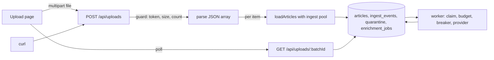

# 0002 Upload a JSON articles file through the ingest and enrichment flow

## 1. Summary
Add a web upload (page plus `POST /api/uploads`) that takes a JSON array of articles, runs each through the existing validate, sanitise and insert path (`loadArticles`), which already queues the `sentiment` and `summary_topics` enrichment jobs the worker picks up. The file is never sent whole to an LLM; each article is enriched individually under the ADR-0010 budget. The request returns a per-article outcome report keyed by a `batch_id`, and a second endpoint lets the page follow each article from `admitted` to `enriched`.

The main decision: the web service today only holds the read-only `app_read` credential, so an upload route needs a write path (D1).

## 2. Requirements digest
Functional
- F1 Upload a JSON file (array of `{id, headline, body, source, published_at, language}`) from the UI or API.
- F2 Each article goes through the same pipeline as the seed loader: validate, reduce markup, insert, enqueue enrichment.
- F3 Return a report: received, admitted, duplicate, quarantined with reason codes, per article position.
- F4 Show enrichment progress for the batch (queued, running, deferred for budget, done, dead).

Non-functional
- N1 No silent loss: every array element ends in `ingest_events` with an outcome (P2, P3).
- N2 Idempotent re-upload of the same file (P2).
- N3 Spend stays bounded by ADR 0010; upload cannot bypass it (P2).
- N4 Any language through the same model (P5).
- N5 Upload data is untrusted (carma-data-sanity).

## 3. Codebase findings
- `src/lib/ingest/ingest.ts` `loadArticles(items, batchKind, pool?, config?)` already does everything per item, with a pool and config that can be injected. One transaction per item, a `batch_id` per call, outcomes `admitted | duplicate | quarantined | error`, duplicate by `(source, external_id)`, content duplicates flagged only. It returns counts only (no per-item list), and it is sequential (about 4 queries per item).
- `ingestOne` inserts `enrichment_jobs` for `sentiment` and `summary_topics` in the same transaction as the article (transactional enqueue, P2).
- `src/lib/validate/article.ts` caps one item at 1 MiB and rejects with reason codes; `src/cli/load.ts` is the only current caller (CLI, `ROLE=seed`).
- `loadArticlesFile` requires the top-level value to be an array and throws otherwise.
- `compose.yaml` web service uses `DB_PASSWORD_FILE=/run/secrets/app_read_password`; container is `read_only` with `cap_drop: ALL`. `ops/init-secrets.sh` copies `app_ingest_password` only to `migrate` and `seed`. Role grants (`db/migrations/0001_init.sql` lines 224-250): `app_ingest` has SELECT/INSERT on articles and INSERT on events, quarantine, transformations and jobs; `app_read` is SELECT only with a 2s statement timeout.
- Existing routes live in `src/app/api/*/route.ts` (Route Handlers). There is no auth, no `proxy.ts`/middleware, and no existing write endpoint.
- Worker (`src/worker/*`) claims `enrichment_jobs`, with budget (`budget.ts`), breaker and retry already in place.
- Not determined: reverse proxy body limits on the target host; Next route handler body size behaviour in this version (read `node_modules/next/dist/docs/01-app/03-api-reference/03-file-conventions/route.md` and `01-app/01-getting-started/15-route-handlers.md` before coding).

## 4. Proposed architecture

Components
- `POST /api/uploads` (new route handler). Checks the shared upload token, content length against `UPLOAD_MAX_BYTES`, parses the file, rejects a non-array or an over-limit item count (`UPLOAD_MAX_ITEMS`) with 4xx and no rows written, then calls `loadArticles(items, "backfill", ingestPool, cfg)`. `backfill` keeps uploads out of the live freshness watermark (P3 honesty: not a live batch).
- `loadArticles` change: also return a per-item result list `{position, outcome, reason_codes, article_id}` (the data is already written to `ingest_events`). Keep the pure function shape (benchmarkable).
- `GET /api/uploads/:batchId` (new): reads `ingest_events` for the batch joined to `enrichment_jobs` states; read-only, can use the existing `app_read` pool (needs SELECT on `ingest_events` for `app_read`; today only `app_ingest` has it, so a one-line grant migration `0003`).
- Upload page (carma-ux): file picker, token field, report table, progress per article.
- Ingest pool in the web process: separate `createPool(...,"web-ingest")` with `app_ingest` credentials, used only by the upload route (D1).
- One in-flight upload per web instance (semaphore, 429 otherwise) so the ingest pool cannot starve search reads.

States per article: `received` (event) then `admitted | duplicate | quarantined`; admitted articles are searchable immediately (fresh before rich, P1) and enrichment jobs move `queued` to `done`, `deferred_budget` or `dead`.

Confidence and lineage: unchanged. Enrichment continues to write confidence, origin and method (P6, P7); each article traces to its upload through `ingest_events.batch_id` and `payload_sha256` (P8). Add `batch_kind`/source label `upload` only if D4 (not needed now) is accepted; otherwise the `batch_id` is the lineage.

Human touchpoint (P9): quarantined items from an upload appear in the existing quarantine review surface with their `batch_id`.

## 5. Options considered
O1 Where the write credential lives
1. Second pool in web using `app_ingest` (recommended): smallest change; mounts one more secret into web. Cost: web can now insert articles and events if compromised.
2. Dedicated ingest service/container with its own port, web proxies to it: strongest isolation, extra service, Compose change, more to run. Over the ADR 0001 scope.
3. Web stages the raw file into a table and a worker ingests it: keeps web read-only except one staging grant, adds new table, worker stage, and delays visibility (P1 cost).

O2 Sync vs async processing of the file
1. Synchronous in the request, bounded by caps (recommended): at about 4 queries per item, 1,000 items is a few to tens of seconds; the caller gets the full report. Cost: long request, ties up the ingest pool.
2. Accept (202) and process in the web process in background: route returns fast, but work is lost on restart and no recovery (P2).
3. Stage and process in a worker (see O1.3): durable, more build.

O3 Authentication
1. Shared upload token from a secret (`UPLOAD_TOKEN_FILE`), constant-time compare (recommended): the only write endpoint should not be open, and it spends LLM budget. Cost: token handling in the UI.
2. No auth, like the rest of the app: simplest, but anyone reaching the port can add data and spend budget.

O4 Idempotency and duplicates (no decision needed): reuse `(source, external_id)` skip plus content-hash flag; re-uploading the same file yields all `duplicate`, zero new jobs.

O5 Extensions: none needed. Core Postgres only.

## 6. Decisions needed
- D1 Write credential for the upload route: option 1 (second `app_ingest` pool in web), 2 (separate ingest service), or 3 (stage then worker). Recommend 1.
- D2 Processing model: sync bounded (recommend), or stage and worker. Linked to D1.
- D3 Authentication: shared token (recommend) or none.
- UNCONFIRMED defaults: `UPLOAD_MAX_BYTES=5 MiB`, `UPLOAD_MAX_ITEMS=1000`, uploads recorded as `backfill`, one upload at a time per instance.

### Decisions recorded
- D1/D2: ADR-0019 (second `app_ingest` pool in web, synchronous under caps)
- D3: ADR-0020 (shared upload token)
- D4 (raised by data-sanity): ADR-0021 (changed re-submission stored as a new version; schema design left to carma-dba)

## 7. Points of failure
| ID | Failure point | Mode and effect | Principle | Detection |
| --- | --- | --- | --- | --- |
| FP-1 | File is not valid JSON or not an array | Whole file rejected 400, nothing written; must say why | P3 | 4xx metric, report body |
| FP-2 | Oversized file or too many items | 413/422 before any write; no partial acceptance | P2 | reject counter by reason |
| FP-3 | Element invalid or non-object | Quarantined with reason code, others continue; position preserved | P3 | `ingest_events` count vs received |
| FP-4 | DB connection drops mid-file | Request fails after some items committed; caller must be able to resume safely | P2 | 5xx; re-upload is idempotent (N2) |
| FP-5 | Client disconnects mid-request | Server continues or aborts partway; batch partly applied without a report | P2 | batch event count vs expected; GET batch shows actual |
| FP-6 | Same file uploaded twice or concurrently | Concurrent identical items race on `(source, external_id)`; ON CONFLICT handles it, one admitted, one duplicate | P2 | duplicate count |
| FP-7 | Upload floods the LLM budget | 1,000 items queue jobs; budget caps spend and defers; lag shown | P2, ADR 0010 | deferred_budget count, budget banner |
| FP-8 | Upload starves search reads | Long upload holds the ingest pool and CPU | P1 | pool wait time, search p95 |
| FP-9 | Token missing/leaked/logged | Unauthorised writes; token in logs | security | 401 counter; log scrub test |
| FP-10 | Hostile article text (markup, injection, huge values, NULs, lone surrogates) | Existing sanitise/validate and ADR 0012 apply; unsafe items flagged | P2 | flags; sanity tests |
| FP-11 | Upload counted as live batch | Corrupts freshness watermark | P3 | batch_kind = backfill assertion |
| FP-12 | Outcome mismatch: received != admitted + duplicate + quarantined | Silent drop | P3 | per-request reconciliation, asserted in response and test |

## 8. Resilience design
| Dependency | Failure classes | Retry | Breaker | Bulkhead | Permanent failures | Degraded mode |
| --- | --- | --- | --- | --- | --- | --- |
| Postgres (ingest pool) | transient: connection reset, 57P01/57P03, deadlock; permanent: constraint/validation (already quarantined per item) | No automatic retry inside the request; the caller re-sends (idempotent, FP-4). Per-item deadlock retry once is acceptable | None (pool errors surface as 503) | Separate ingest pool, one upload at a time, UPLOAD_MAX_ITEMS | Item errors recorded as `ingest_error` quarantine | 503 with `Retry-After`; reads keep working on the read pool |
| LLM providers | unchanged: worker retry, breaker and budget (ADR 0010, existing `src/worker/*`) | existing | existing | existing worker concurrency | dead-letter existing | Articles searchable, enrichment shows queued/deferred, confidence "none yet" |
| Client | disconnect, slow upload | none | n/a | request timeout and body limit | n/a | Partial effects visible through `GET /api/uploads/:batchId` |

## 9. Hot paths
| ID | Path | Why hot | Expected load | What needs a human | Measurement |
| --- | --- | --- | --- | --- | --- |
| HP-1 | `ingestOne` per upload item | 4+ queries per item, sequential | up to 1,000 items per request | Decide batch limits and whether to batch inserts after measuring; inspect transaction scope | items/s and request p95 for 1,000 items on the small DB profile |
| HP-2 | JSON parse of up to 5 MiB in the web process | Blocks the event loop | one at a time | Confirm limit vs memory limit of the container (mem_limit in compose) | peak RSS, event-loop lag |
| HP-3 | Batch status query | Join events to jobs for a batch | polling every few seconds | Review plan on `events_batch_idx` | query p95 |

carma-benchmark candidates: HP-1 (completeness `received = accounted for`, plus throughput).

## 10. Telemetry starting points
`upload_requests_total{outcome}`, `upload_rejected_total{reason}`, `upload_items_total{outcome}`, `upload_duration_seconds`, ingest pool wait/usage, in-flight upload gauge, 401/429 counts, batch reconciliation mismatch counter (must stay 0), deferred_budget jobs for upload batches, event-loop lag, plus existing worker, queue age and breaker signals. Log batch_id, byte size, item count, never the file contents or token.

## 11. Principle alignment
| Principle | Serves | Costs |
| --- | --- | --- |
| P1 | Admitted articles searchable before enrichment | Sync upload holds the request |
| P2 | Per-item transactions, transactional enqueue, idempotent re-upload | No resumable upload; caller re-sends |
| P3 | Every element has an outcome, whole-file rejects are loud | Upload caps may refuse legitimate big files |
| P6/P7/P8 | Unchanged enrichment confidence, batch_id lineage | None |
| P9 | Quarantine review covers uploads | Review UI scope unchanged |

## 12. Downstream handoff
- carma-searchability: no new query needs; uploaded articles are searchable through existing paths. Run only if routing wants confirmation. Skip suggested.
- carma-data-sanity: apply. Untrusted file: size and count caps, content-type, JSON depth, filename handling, injection into LLM (ADR 0012), token handling.
- carma-dba: small. Grant `SELECT` on `ingest_events` to `app_read` (or a status function), ingest pool in web, per-batch index check; possibly a `status_batch(batch_id)` SQL function.
- carma-telemetry: apply (section 10).
- carma-ux: apply. Upload page, report table, per-article progress.
- carma-devops: apply. Mount `app_ingest_password` and `UPLOAD_TOKEN` secret into web (`ops/init-secrets.sh`, `compose.yaml`), request body limits, container memory.
- carma-backend-testing: apply (FP-1..FP-12, reconciliation, idempotent re-upload, fault injection on the DB).
- carma-plan: last.
- carma-benchmark after code: HP-1. carma-review: keep `ingestOne` untouched and the route handler thin.

## 13. Open questions and assumptions
- UNCONFIRMED: caps 5 MiB / 1,000 items; `backfill` kind; single in-flight upload; token auth.
- UNCONFIRMED: whether Next.js route handlers in this version stream or buffer `request.formData()` and its default size limits (check docs before coding).
- Is the upload meant for operators only (internal) or for external clients? Affects D3.
- Should an upload file be retained after processing? Assumed no (only per-item payload hashes, quarantine payload per ADR 0011).
