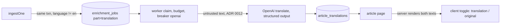

# 0003 Show a translated full text for non-English articles, with a reveal-original button

## 1. Summary
Add a third enrichment part, `translation`, that produces an English version of the headline and body for every article whose `language` is not English. It runs through the existing job queue, worker, budget, breaker and retry code (queued transactionally at ingest, like `sentiment` and `summary_topics`). The article page shows the English text by default with a clear "Machine translated from <language>" label, and a button that swaps to the untouched original. The original stays the system of record and is never overwritten.

Main decision (D1): translate at ingest for every foreign-language article, or lazily on first view. The rest follows from that (D2 provider, D3 long bodies).

## 2. Requirements digest
Functional
- F1 For `language != en`, the article view shows a translation of headline and full body by default.
- F2 A button reveals the original text, and lets the reader go back to the translation.
- F3 English articles are unchanged: no translation, no button.
- F4 Search matches the original text and the translated text (user request, ADR-0025); results show which side matched.

Non-functional
- N1 Any language through the same model; nothing hard-coded to Arabic or Chinese (P5). Right-to-left original and left-to-right translation must both render correctly.
- N2 Honest states: translated, translation pending, deferred for budget, failed, not needed. Never show the original silently labelled as a translation (P3).
- N3 Translation is derived data: store origin, model, prompt version, input hash, and a confidence or an explicit "no confidence available" (P6, P7).
- N4 Spend stays under ADR 0010; untrusted text is handled per ADR 0012 (P2).
- N5 Translated text is a new version-bound artefact: a changed resubmission (ADR 0021) invalidates it.

Principles touched: P3, P5, P6, P7, P8, P9.

## 3. Codebase findings
- Job model: `enrichment_jobs.part` and `enrichments.part` are CHECK-constrained to `sentiment | summary_topics` (`db/migrations/0001_init.sql:52,78`). Unique key per `(article_id, article_version, part, prompt_version)` after `0003_article_versions.sql`.
- Enqueue: `ingestOne` inserts both jobs in the article transaction (`src/lib/ingest/ingest.ts:527`).
- Worker: `src/worker/loop.ts` hardcodes the two parts and two breakers (`jev`, `openai`); `claim.ts`, `finish.ts` have the part union typed in. Adding a part touches all of these, so the union should become a shared type rather than a third copy.
- Providers: `EnrichmentProviders` has `classifySentiment` and `summariseAndTag` (`src/lib/providers/types.ts`); OpenAI adapter uses structured output and a prompt token cap (`openai.ts`, `src/lib/enrich/prompt.ts`). Mock adapter exists (`mock.ts`, ADR 0013).
- Output store: `derived_values.field` is limited to `sentiment | summary | topic` with a required confidence block (`0001_init.sql:102,115`). A translation is a long text, not a short value.
- Page: `src/app/articles/[id]/page.tsx` renders `a.body` with `TextBlock` (`dir="auto"`, `lang`, bidi isolate). The page is a server component with no client interactivity today; a toggle needs a small client component (read the Next docs in `node_modules/next/dist/docs/` for client components before coding, per `AGENTS.md`).
- Language values: stored as supplied text (`articles.language`); the sample data uses short codes. Whether values are always ISO 639-1 is UNCONFIRMED.
- Not determined: share of non-English articles, average body size, OpenAI model id and price (still blocked in ADR 0003), whether the list/search views should show translated headlines too.

## 4. Proposed architecture

Components
- Migration `0004`: widen the `part` CHECKs to include `translation`; new table `article_translations(article_id, article_version, target_lang, headline_en, body_en, source_lang, enrichment_id, input_truncated, created_at, superseded_at)` with a unique index on the current row per `(article_id, target_lang)`, a GIN on `search_vector` and a trigram GIN on `search_text` (ADR-0025). The search compiler ORs `articles.search_*` with an EXISTS on the current translation row. Translated text is kept apart from `articles` so the original is never at risk (P8).
- Enqueue rule in `ingestOne` and the new-version path: add a translation job when the language is not English. Language test is a small pure function (`isEnglish(lang)`: `en`, `en-*`), unit-testable, with unknown or missing language treated as "needs translation check" rather than skipped (P3).
- Provider: `translate(text, headline, sourceLang)` on `EnrichmentProviders`, OpenAI adapter and mock adapter (mock output marked as mock, origin `mock`, ADR 0013). Reuses the `openai` breaker and budget ledger (same vendor).
- Long bodies: split on paragraph boundaries into chunks under the token cap, translate each, join; `input_truncated` stays true only if a hard cap is hit and the page says so (D3).
- Page: server fetches the current translation row; renders both texts in the HTML (so no extra request on toggle and original is available without JS issues); a small client component `TranslatedText` switches which is visible. Default is translation when a row exists. States: no job yet or pending ("Translation in progress, showing original"), deferred for budget, failed (original shown with reason), translated. Each text block is its own `TextBlock` with its own `lang`/`dir` (translation `lang="en"`, original its own language).
- Confidence and lineage: translation row links to `enrichments` (provider, model, prompt version, input hash, cost); confidence is "no confidence available" unless D4 says otherwise (P6, P7). Label reads "Machine translated, not human-reviewed" (P9).

## 5. Options considered
D1 When to translate
1. At ingest, every non-English article (recommended): reader never waits, state is simple, fits the existing job flow. Cost scales with the foreign-language share, spent whether anyone views it.
2. Lazy on first view: spends only on viewed articles, but the first reader waits for an LLM call on a read path (read pool is SELECT-only, 2s timeout), needs a write path from the web app, and complicates the failure UX.
3. Hybrid: ingest-time for recent articles, lazy for backfill. Most efficient, most moving parts.

D2 Translation provider
1. OpenAI small model already integrated (recommended): one more prompt, existing key, breaker and budget.
2. jev: it is a classifier, not a translator; not suitable.
3. Dedicated MT API (DeepL, Google): better price per character for pure translation, a new vendor, key, breaker, budget and data-processing review.

D3 Long bodies
1. Chunk by paragraph and join (recommended): full text honoured as asked.
2. Truncate at the prompt token cap: simple, but violates "full text".

D4 Confidence for translation
1. None, shown as "no confidence available" (recommended): LLM self-reported translation quality is weak evidence (P7).
2. Model self-report with origin `llm_self_report`, like summary.

Extensions: none needed. Core Postgres only.

## 6. Decisions needed
- D1 timing of translation (options above, recommend ingest).
- D2 provider (recommend OpenAI small model).
- D3 chunking vs truncation (recommend chunking).
- D4 confidence (recommend none).
- D5 scope of translated display: article page only (decided, ADR-0024), amended: search covers both original and translation (ADR-0025).

## 7. Points of failure
| ID | Failure point | Failure mode and effect | Principle | Detection |
| --- | --- | --- | --- | --- |
| FP-1 | Job never enqueued for a foreign article (language check wrong, new-version path forgotten) | Reader sees original with no translation and no state | P3 | Reconcile: non-English articles without a translation job, by version |
| FP-2 | Translation job dead or deferred | Original shown; must be labelled, not blank | P3 | Job state counts, page state test |
| FP-3 | Chunk join drops or duplicates a paragraph | Silent loss of content | P3, P8 | Paragraph count check, length ratio bounds |
| FP-4 | Model returns text in the wrong language, or just echoes the original | Wrong text labelled as English translation | P6 | Output language check, equality-with-original check |
| FP-5 | Prompt injection in the article body changes the translation | Attacker-controlled text shown as the "translation" | P2 | ADR 0012 detector, low-trust flag shown on the page |
| FP-6 | Changed resubmission leaves old translation attached to a new version | Translation does not match the original | P8 | Translation `article_version` must equal the current version |
| FP-7 | Mixed-direction rendering (Arabic original, English translation, or the reverse) | Garbled order, wrong alignment | P5 | UI test with RTL and CJK |
| FP-8 | Budget exhausted, translation volume starves sentiment and summary | Core enrichment delayed | P3 | Separate translation budget share or lower priority (see Open questions) |
| FP-10 | Search ignores translations, or matches a superseded translation | Foreign article not found by English term, or found by text no longer shown | P3 | Search tests on both sides, current-row filter |
| FP-9 | Article already English but tagged with another code, or the reverse | Wasted spend or missing translation | P3 | Language-detect sample audit |

## 8. Resilience design
| Dependency | Failure classes | Retry | Breaker | Bulkhead | Permanent failure | Degraded mode |
| --- | --- | --- | --- | --- | --- | --- |
| OpenAI translate | Transient: timeout, 429, 5xx. Permanent: 400, 401, 403. Invalid output: wrong language, empty, echo of input | Existing `retry.ts` backoff with jitter; invalid output has its own bounded count | Reuse the `openai` breaker; separate breaker name `openai-translate` recommended so a long translation outage does not trip summaries | Own concurrency setting and claim loop for the part | Job goes `dead` with reason, replayable; page shows original with reason | Show original, label "Translation unavailable", never an empty body |
| Database | Existing handling | n/a | n/a | n/a | n/a | n/a |

## 9. Hot paths
| ID | Path | Why hot | Load | Human check | Measurement |
| --- | --- | --- | --- | --- | --- |
| HP-1 | `ingestOne` enqueue branch | Per article, adds one INSERT for foreign articles | Up to full ingest rate at 800/s | Confirm one extra insert per foreign article stays inside the transaction budget; batch the job inserts if the benchmark shows a drop | Ingest rows/s with and without the branch (carma-benchmark) |
| HP-2 | Translation worker | Token volume is about equal to the full body, far above summaries | Depends on foreign share, UNKNOWN | Decide concurrency and budget share from measured cost | Tokens and spend per article, queue age |
| HP-3 | Article page query | One extra indexed lookup | Interactive | Check the plan uses the current-row unique index | p95 page time |

## 10. Telemetry starting points
Translation jobs by state, queue depth and oldest age, translation latency and tokens per article, spend share of the budget, breaker state for translate, invalid-output rate by reason (wrong language, echo), dead-letter depth, reconciliation: foreign articles = translated + pending + deferred + dead + skipped, toggle-click rate (UI event) to see if the original is used.

## 11. Principle alignment
| Principle | Served by | Cost |
| --- | --- | --- |
| P3 | Original always kept and one click away; explicit states for pending, failed, deferred | More states in the UI |
| P5 | Any language through one part; per-block `lang` and `dir` | Language-code normalisation needed |
| P6, P7 | Provider, model, prompt version, input hash stored; labelled machine translation; no invented confidence | No quality number for the reader |
| P8 | Translation tied to article version and enrichment row | New table |
| P9 | Marked automated; reader can always check the original | No human edit path yet (out of scope) |
| P1 | Translation arrives after the article is searchable (fresh before rich) | Short gap where only the original is shown |

## 12. Downstream handoff
- carma-searchability: applies (ADR-0025): query compiler change, indexes on translations, matched-in-translation marker, pending-translation coverage note.
- carma-data-sanity: applies (untrusted text to an LLM, long inputs, cost).
- carma-dba: applies (new table, CHECK change, enqueue write cost, retention).
- carma-telemetry: applies.
- carma-ux: applies (toggle, states, RTL/LTR).
- carma-devops: light touch (new env settings: translate model, concurrency, budget share); no new service.
- carma-backend-testing: applies (FP-1 to FP-9).
- carma-plan: last.
- carma-benchmark: HP-1 after the code change. carma-review: keep the enqueue branch and the chunk join simple.

## 13. Open questions and assumptions
- Share of non-English articles and average size: unknown. UNCONFIRMED.
- Translation budget: shared with the `openai` daily cap or separate? Default: separate share, UNCONFIRMED.
- Target language: English only (UNCONFIRMED; the table keeps `target_lang` so a second target is possible).
- Whether `language` values are always clean ISO codes. UNCONFIRMED.
- Headline translated together with body in one call (assumed).

## Decisions recorded
ADR-0022 (timing), ADR-0023 (provider and chunking), ADR-0024 (no confidence, article page; its search clause superseded), ADR-0025 (search covers original and translated text), ADR-0026 (English headline on all foreign cards), ADR-0027 (NOT original-side only; trigram on translations), ADR-0028 (no backfill).
