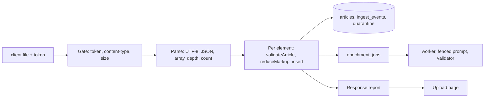

# 0002 Sanitising the JSON file upload surface

## 1. Summary
Article-level sanitation (per-field validation, markup reduction, quarantine, prompt-injection controls, LLM budget) already exists in spec 0001 and the code, and the upload reuses it unchanged. This spec covers only what is new: the **file envelope** (size, shape, encoding, nesting), the **upload endpoint** (token, concurrency, response contents), **amplification** (one file becoming many writes and many LLM jobs), and **second-order exposure** of upload metadata (filename, response echo). Principle: a bad file is refused whole, loudly, before any write; a bad element never refuses the file, it is quarantined with a reason (P3).

## 2. Trust boundaries and consumers

| Consumer | Exposure | Control |
| --- | --- | --- |
| Gate | Unauthenticated bytes, oversized body | Token check before reading the body; reject on `Content-Length` and on bytes read |
| JSON parser | Huge numbers, deep nesting, duplicate keys, non-UTF-8 | Limits in section 3 |
| `ingestOne` | Hostile elements | Existing, spec 0001 section 3 |
| Response / UI | Reason codes and positions echoed back; client filename | Return codes and counts only, never article text or the filename unescaped |
| Logs | File metadata | Hash, size, count, batch id only |
| LLM worker | Article text | Existing fencing, validator, ADR 0012 |

Codebase findings (paths):
- F1 `src/lib/ingest/ingest.ts:24` `loadArticlesFile` does `JSON.parse(readFileSync(...))` with no size, depth or count bound; fine for a CLI, unsafe for a request. The upload path must enforce caps before calling `loadArticles`.
- F2 `ingest.ts:46-67` returns counts only. For N1 (reconciliation) the route must also receive a per-item list; `received = admitted + duplicate + quarantined` already holds because `error` is counted as quarantined (`ingest.ts:52-55`), but `quarantined` and `errors` overlap in the returned object, which makes the report ambiguous. The report must not add them.
- F3 `ingest.ts:206` `JSON.stringify(item)` on each element; an element that is `undefined`/BigInt is impossible from `JSON.parse`, so it is safe for parsed input, but not for objects built another way. Keep the route parsing strictly from text.
- F4 Same `(source, id)` appearing twice in one file with different content: the second is recorded only as `duplicate_id`; the differing text is not kept. This silently discards a variant (P3, P8). See U-D3.
- F5 `src/lib/validate/article.ts:40` computes size by re-serialising; element cap 1 MiB is retained. With a 5 MiB file the quarantine copy per element (`ingest.ts:152`, capped 1 MiB) cannot exceed the file size, so storage amplification is bounded at about 1x the file.
- F6 `app_ingest` has no `statement_timeout` (only `app_read` has, `db/migrations/0001_init.sql:250`). The web ingest pool must set one.

## 3. File and request rules (new)
| Rule | Value | Outcome | Reason code (response) |
| --- | --- | --- | --- |
| Token | Bearer header equals secret, constant-time compare, checked before the body is read | 401, no rows | `unauthorized` |
| Concurrency | One upload in flight per web instance | 429 with `Retry-After` | `upload_busy` |
| Content type | `multipart/form-data` with one `file` part, or `application/json` body | 415 otherwise | `unsupported_media_type` |
| Size | `UPLOAD_MAX_BYTES`, default 5 MiB (UNCONFIRMED), enforced on declared length and on bytes actually read | 413 before parse | `file_too_large` |
| Encoding | Must decode as strict UTF-8; strip a leading BOM; invalid sequences are an error, not replaced | 400 | `invalid_encoding` |
| Shape | Top-level value must be an array | 400 | `not_an_array` |
| Count | `UPLOAD_MAX_ITEMS`, default 1000 (UNCONFIRMED); empty array allowed and returns an empty report | 422 | `too_many_items` |
| Nesting depth | Reject deeper than 8 levels (checked by a bounded parse or pre-scan) | 400 | `too_deep` |
| Element type | Non-object elements are not refused; they are quarantined | `payload_invalid` per item | existing |
| Duplicate keys inside an object | JSON.parse keeps the last; accepted, the payload hash covers the original text of the element | none | n/a |
| Filename | Never used for any path or stored; at most a sanitised display label of 100 characters in the response (control and bidi characters removed) | | |
| Empty file / no `file` part | 400 | `empty_file` |

Whole-file rejects write nothing (not even `ingest_events`) because no element was received; the rejection is counted in a metric (`upload_rejected_total{reason}`). Once parsing succeeds, every element must end in an `ingest_events` row (N1).

## 4. Null and failure handling
Existing rules and the null matrix in spec 0001 section 4 apply per element. New upload-level rules:
- Route returns a `Result` from the gate and parse stages with a reason code; no exceptions for control flow.
- `loadArticles` is called inside a try; connection errors map to 503 `db_unavailable` with `Retry-After`, never to a success with zero counts. Any other unexpected error maps to 500 `internal_error` and states that earlier items in the batch may already be stored and can be listed by `batch_id` (FP-4, FP-5).
- The response always carries `received`, per-outcome counts, per-item list, and a boolean `reconciled` (`received == admitted + duplicate + quarantined`). If false, the response is a 500 and the mismatch counter increments (FP-12).
- Missing token secret at startup: the upload route returns 503 `upload_disabled` and `readyz` stays green; it must never fall back to "no auth".

## 5. Unicode and encoding policy
Per-element policy unchanged (spec 0001 section 5). New: strict UTF-8 decoding of the file (`TextDecoder` with `fatal: true`); a file in UTF-16 or Windows-1256/GBK is rejected with `invalid_encoding` rather than silently mojibaked (Arabic and Chinese content from legacy encodings is the likely cause, so the error message says "re-save as UTF-8"). Escaped `\u0000` inside strings is accepted by JSON but removed per element by `repairText` and recorded.

## 6. SQL injection controls
No new SQL strings are built from the file. All inserts remain parameterised (`ingest.ts`). The new batch-status endpoint takes `batch_id` and must validate it as a UUID before use and bind it as a parameter. The ingest pool uses `app_ingest` (INSERT/SELECT only on listed tables); the status read uses `app_read`.

## 7. XSS controls
Responses are JSON with `Content-Type: application/json` and `X-Content-Type-Options: nosniff`. The upload page renders reason codes, counts, positions and article ids as text. It does not render article headlines from the response (the response does not include them). Any filename shown is rendered as text. CSP from the existing app applies; no inline handlers.

## 8. Prompt injection controls
Unchanged: each article is enriched individually with fenced text and validated output; the raw file never reaches a model (architect section 1). New: because an upload can enqueue up to 1000 jobs at once, a file seeded with injection text across all elements produces many `possible_prompt_injection` flags; flagging is a signal, not a drop (ADR 0012), and a spike in `prompt_injection_suspected` for one batch is surfaced in the batch report (`flags` counts) so a human can look (P9).

## 9. Loop and cost controls
| Control | Value | Notes |
| --- | --- | --- |
| Max spend exposure per upload | `UPLOAD_MAX_ITEMS` x 2 jobs (sentiment, summary_topics) x capped input tokens | Bounded further by ADR 0010 daily budget; excess becomes `deferred_budget`, never dropped |
| Re-upload amplification | Same file again yields all `duplicate`, zero new jobs | `ON CONFLICT (source, external_id) DO NOTHING` |
| Content-changed re-upload | Same ids, new text: new version created and enrichment re-queued (ADR-0021); each changed element costs 2 jobs, bounded by the item cap and ADR 0010 | |
| Upload rate | One in flight per instance; plus a per-token limit of 10 uploads per hour (proposed) | Stops a loop in a script calling the endpoint; 429 `rate_limited` |
| Statement timeout | 10 s on the ingest pool (proposed) | A stuck item cannot hold the pool |
| Request deadline | 60 s overall (proposed) | On breach return 504 with batch_id and actual counts |
| Parse CPU | 5 MiB limit keeps parse under about 50 ms | Measure (HP-D1) |
| Kill switch | `UPLOAD_ENABLED=false` makes the route return 503 `upload_disabled` without redeploy of data | Config, not code |
| Retries | Server does not retry; client re-sends safely (idempotent) | |

## 10. Quarantine and flagging design
No new tables. Uploaded items use the existing `ingest_events` and `ingest_quarantine`, with `batch_kind = 'backfill'` and a `batch_id` the report returns. Open quarantine items from an upload are replayable through the existing path and are subject to ADR 0011 retention. Completeness: whole-file rejects never touch the ledger (nothing was received), so the response itself is the record; the metric counts them by reason.

## 11. Security and null-handling test inputs (for carma-backend-testing)
File level: no token; wrong token; token of different length (timing-safe compare); body one byte over the cap, exactly at the cap, and declared `Content-Length` smaller than the real body; chunked body without length; multipart with two `file` parts; multipart with a huge non-file field; wrong content type; empty file; whitespace-only file; BOM-prefixed file; UTF-16 file; Latin-1 and Windows-1256 bytes; truncated JSON; valid JSON that is an object, a string, `null`, a number; array with 1001 items; array of 1000 items at the cap; nesting 9 deep; 100k-deep brackets; very long single string at 5 MiB; NaN/Infinity tokens (invalid JSON); filename with bidi controls, `../`, NUL, 10k characters; two concurrent uploads; upload while DB is down and while DB restarts mid-file; client abort mid-body and mid-processing; same file twice; same file concurrently twice; same `(source, id)` twice in one file with different text.
Element level: the existing list from spec 0001 section 11, run through the upload path, including Arabic and Chinese articles with bidi/zero-width characters, `<script>` text, SQL fragments, NUL, lone surrogates, prompt-injection strings in all three languages, future/missing `published_at`.
Response checks: `reconciled` is true; no article text or token appears in the response, logs or error bodies.

## 12. Telemetry signals (for carma-telemetry)
`upload_requests_total{outcome}`, `upload_rejected_total{reason}` (reasons in section 3), `upload_items_total{outcome}`, `upload_bytes` histogram, `upload_items` histogram, `upload_duration_seconds`, `upload_in_flight` gauge, `upload_reconcile_mismatch_total` (must stay 0), `upload_auth_failures_total`, `upload_rate_limited_total`, plus per-batch flag counts. Logs: batch_id, byte size, item count, content hash of the file, outcome; never file text, filename raw, or token.

## 13. Risks and hot paths
| ID | Entry | Detail |
| --- | --- | --- |
| FP-D1 | Body larger than declared or unbounded stream | Memory exhaustion in the web container; enforce on bytes read |
| FP-D2 | Token compare timing or token logged | Use constant-time compare; scrub headers from logs |
| FP-D3 | Whole-file reject writes partial rows | Gate and parse complete before the first write |
| FP-D4 | Ambiguous counts (`errors` overlapping `quarantined`) | Report uses the three disjoint outcomes only (F2) |
| FP-D5 | Same id re-uploaded with changed text silently ignored | F4, ADR-0021 (new version); sanity needs: version-aware dedupe, enrichment re-queue bounded by budget |
| FP-D6 | Upload used to burn LLM budget | Item cap, rate limit, ADR 0010 |
| FP-D7 | Legacy encodings mojibake | Strict UTF-8 |
| HP-D1 | Parse plus validate loop for 1000 items inside the web process | Event loop blocked; measure lag; consider yielding between items |
| HP-D2 | Reading the full body into memory | Peak RSS vs container `mem_limit` |

## 14. Decisions needed and open questions
| ID | Question | Options |
| --- | --- | --- |
| U-D1 | Per-token upload rate limit (proposed 10 per hour) | (a) in-memory counter per instance (recommended, adequate for single host); (b) none, rely on one-at-a-time and caps |
| U-D2 | Strict UTF-8 only (recommended) | (a) strict reject; (b) try to sniff and transcode (risk: silent mojibake, P5) |
| U-D3 | DECIDED (ADR-0021): store as a new version, old version kept. Options were: (a) keep current behaviour but flag the duplicate event `duplicate_id_changed_content` and keep the variant payload in the event for review (recommended; P3, P8); (b) leave as is, silent; (c) store as a new version (schema change, out of scope) |
| Open | Limits 5 MiB, 1000 items, depth 8, 10 s statement timeout, 60 s deadline | all UNCONFIRMED proposals |
| Open | Does a reverse proxy on the target host impose a lower body limit than `UPLOAD_MAX_BYTES`? | check in devops |
