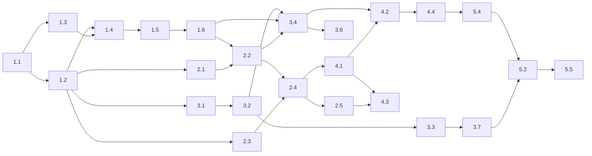

# Execution plan: Media Signal Service

## 1. Summary

> **Decision update 2026-10-24 (ADR-0018):** build time is not a constraint. **Track F is the build target**, together with task 5.6 (observability profile) and the COULD test tier (new task 5.7). Blocker B1 is resolved. Track B estimates and the cut order in section 9 are kept as reference only; use them if a time limit is introduced later. ADR-0001 (assignment sizing, 800/s as a documented growth path) is unchanged.

**What is built:** a fullstack service (Next.js + TypeScript, PostgreSQL, Docker Compose) that loads news articles, makes them searchable with a boolean query language, enriches them asynchronously with jev (sentiment) and an OpenAI small model (summary and topics), and shows search, trends, article and status screens. It is the Senior Fullstack home assignment, built to Carma principles with a documented growth path to 800 articles a second (ADR-0001).

**Size, honestly.** Summing the task estimates in this plan gives:

| Track | What it contains | Estimate (hours, AI-assisted, human review included) |
| --- | --- | --- |
| **B** (brief-minimum) | Everything the brief grades, with the thinnest version of each guardrail and the MUST test tier | **11.7 to 16.4** |
| **F** (full specs) | Everything in the nine specs except the optional observability stack | **21.0 to 32.7** |
| **G** (growth backlog) | Prometheus/Grafana profile, 800/s work | 1.0 to 1.5 (profile only) plus unplanned |
| The brief's own guidance | "About 7 to 9 focused hours", return within 5 calendar days | 7 to 9 |

So **even the minimal track is estimated above the brief's 7 to 9 hours**, and the full specs are roughly three times it. The brief grades decisions and trade-offs and says "don't gold-plate"; the specs are deliberately deeper than a 9-hour build can hold. The plan therefore labels every task with a track (B or F) and gives both estimates. The recommended default is **track B**, with F items taken in the order listed in section 9 as time allows. The user has to choose the track (blocker B1); phases 1 to 2 are mostly common to every track, so work can start before the choice.

**Build target after ADR-0018:** track F plus 5.6 and 5.7, about 23.7 to 36.7 hours of agent and review effort (21.0 to 32.7 plus 2.5 to 4.0), phases of 3.5 to 8.5 hours.

**Phases:** 5, each ending in a safe stop that is verifiable. The skill's usual phase size is 8 to 16 hours; with a total of 12 to 16 hours (track B) that would give one or two phases and no review gates, so phases here are 2 to 5 hours each. This is a deliberate deviation.

**Critical path (track B):** repo and Compose skeleton (1.1 to 1.4) → verify unknowns (1.5) → schema and migrations (1.6) → ingest pipeline (2.2) → search and list API (2.4) → worker (3.4) → UI cards (4.2) → deployment checks (5.4) → README (5.2) → transcript (5.5).

## 2. Inputs

All specs for the feature exist:

| Skill | Path | Status |
| --- | --- | --- |
| carma-architect | `.specs/architect/0001-media-signal-service.md` (+ addendum), ADRs 0001 to 0017 | draft design; ADRs accepted |
| carma-searchability | `.specs/search/0001-media-signal-service.md` | draft |
| carma-data-sanity | `.specs/data/sanitization/0001-media-signal-service.md` | draft |
| carma-dba | `.specs/data/dba/0001-media-signal-service.md` | draft |
| carma-telemetry | `.specs/telemetry/0001-media-signal-service.md` | draft |
| carma-ux | `.specs/ux/0001-media-signal-service.md` | draft |
| carma-devops | `.specs/devops/0001-media-signal-service.md` | draft |
| carma-backend-testing | `.specs/testing/backend/0001-media-signal-service.md` | draft |

Routing: all skills ran; none were skipped by choice. `carma-benchmark` and `carma-review` run outside the flow, after code exists, and are scheduled here as gates (tasks 2.7, 3.8). Source documents: `.specs/references/Senior-Fullstack-Home-Assignment.pdf` and `sample_articles.json`. Earlier plans: none.

## 3. Blockers and open questions

| # | Item | Needed from | Blocks | Options |
| --- | --- | --- | --- | --- |
| **B1** | ~~Which track to build~~ **Resolved 2026-10-24: track F** (ADR-0018) | User | none | Build everything specified, plus 5.6 and 5.7 |
| B2 | Exact OpenAI model id | User | 3.3 (real adapter configuration), 3.7 | Supply the id; mock and tests proceed without it |
| B3 | Prices for jev (not published in its docs) and the OpenAI model; input-size limits for jev | User, from the providers' console or price pages | 3.7 cost analysis, real-mode start (cost guard needs prices) | Supply prices; the README cost analysis stays as formula with placeholders until then |
| B4 | API keys for jev and OpenAI | User, **via `.env` only, never in chat or the repository** | 3.7 real-provider smoke test | Without keys the whole build and test suite still run in labelled mock mode (ADR-0013) |
| B5 | Daily budget cap values per provider | User, after B3 | Not blocking (small placeholders are set) | Confirm numbers when prices are known |
| B6 | Host CPU, RAM, disk | User or `docker info` | Not blocking (risk) | Recorded by task 1.5 |
| B7 | The LLM transcript: which sessions count | User | 5.5 | Export this planning session and the build sessions |

Nothing else requires the user before work starts. Gate tasks (1.5) verify technical unknowns; their outcomes may change task details but are expected to be small.

## 4. Consistency report

### Contradictions and their resolution

| # | Finding | Class | Resolution in this plan |
| --- | --- | --- | --- |
| K1 | The DBA claim statement increments `attempts` at claim time; the architect and telemetry designs say jobs waiting on an open breaker must not die (testing C1) | **Blocker for 3.4/3.5** (design fix, no user input) | Adopted: the worker checks the breaker for a part **before** claiming for it; a claim followed by an immediate non-call release decrements `attempts`. Test `F-BRK-ATT` must pass. Written into tasks 3.4 and 3.5 |
| K2 | Search spec section 3 mentions headline/body weights; DBA 4.1 builds one unweighted vector | Note, resolved | Unweighted (recency-only ordering, ADR-0016). Task 2.4 notes the search spec wording as superseded; update the search spec text in task 5.2 |
| K3 | Telemetry needed `ingest_events.batch_kind` and worker writes to `system_flags` keys | Note, resolved | Already applied to the DBA spec; implemented in 1.6 and covered by I-ROLE-1 |
| K4 | UX gaps G1 (`articles_matching_base_filters`) and G2 (`/api/facets`) | Note, resolved | Added to the search spec; implemented in 2.4 and 2.5 |
| K5 | Search spec error table lists an empty query as an error, but its held default says "empty query means no text filter" | Note, resolved | Empty or whitespace query = list view with no text predicate; the error row is removed in implementation (task 2.3) |
| K6 | Drill-through from the hatched "Not yet enriched" bar needs a filter value the search spec does not define | **Gap, blocker for 4.3 correctness** | Task 2.4 adds `sentiment=not_enriched` and `topic=not_enriched` (articles with no current value); I-DRILL tests the bar/list equality for that series |
| K7 | UX uses date-only `from`/`to` in URLs; the API uses timestamps | Risk | Define in 2.4: date-only values mean 00:00:00Z; `to` is exclusive; the API echoes the resolved half-open range |
| K8 | DevOps needs a Dockerfile `test` target, `MOCK_LATENCY_MS`, and a `test`/`fakes` profile | Gap, resolved | Tasks 1.3, 1.4, 3.1 |
| K9 | Testing needs a `Clock` seam, pure modules, and an in-process worker | Gap, resolved | Task 1.2 and 3.4 |
| K10 | The brief allows mocking "if you include realistic example outputs and document the real integration" | Gap | Task 3.1 requires the mock to give realistic output (lexicon sentiment with probabilities, extractive summary, keyword topics) and the README documents the real integration (3.7, 5.2) |
| K11 | UX status screen assumes "live batches" for freshness; all loaded data is a historic backfill | Note | Status page shows "No live batches yet" for freshness SLIs; capture-lag display is by `batch_kind` |
| K12 | Every sample article has a distinct source | Note | Source is a filter only, never a `group_by` (search spec); do not build a source chart |
| K13 | The third PDF example (`AI AND ("healthcare" OR "diagnostic") AND NOT startup*`) returns zero rows on the sample | Note | Correct behaviour; it is an empty-result test with positive control G3a (README explains) |
| K14 | The topic vocabulary list (ADR-0009) is not written anywhere | Gap, resolved | Task 3.2 writes it (suggested list below) |

### Unvalidated assumptions

| # | Assumption | Check | Task |
| --- | --- | --- | --- |
| A1 | `pg_trgm` classifies Chinese and Arabic characters as alphanumeric in the chosen image, so trigram indexing works | E1 `show_trgm(...)` | 1.5 (UNCONFIRMED until run) |
| A2 | Docker Desktop 27.2.0 / Compose 2.29.2 support `subpath` volume mounts, `env_file` with `required: false`, and `up --wait` with exited one-shots | Try each | 1.5 |
| A3 | Exact Postgres major and tag pin (16 assumed), Node 22 base image tag, Alpine tag | Pull and record | 1.5 |
| A4 | `published_at` is accurate; `id` is unique per source | Unknown; enforced by `(source, external_id)` and validation | 2.2 |
| A5 | Real article size 1 to 5 KB and duplicate rate unknown | Measure on synthetic data; report as ranges | 2.6, 3.7 |
| A6 | OpenAI request/response shapes and structured-output syntax | **Not yet looked up**; read the provider's current documentation at implementation | 3.3 |
| A7 | jev request/response shape | Taken from `https://docs.typesafe.ai/introduction/quickstart.md` (2026-10-24); input limits and pricing unknown | 3.3 |
| A8 | Postgres `simple` tokenisation matches the oracle for the golden queries | Differential test | 2.4, 2.6 |
| A9 | Host RAM sufficient for the stack (about 1.7 GB) | `docker info` | 1.5 |

### Principle conflicts

| Conflict | Where recorded |
| --- | --- |
| Spec depth vs the brief's "don't gold-plate" and 7 to 9 hours | Resolved by ADR-0018 (full scope; README keeps to decisions and trade-offs) |
| P3 completeness vs cost: a budget cap delays enrichment | ADR-0010 (defer, never drop) |
| P3 recall vs precision: substring leaves match inside words | ADR-0007 |
| P6/P7 vs mock: mock output could be mistaken for real | ADR-0013 (origin `mock`, UI label) |
| Raw-markup minimisation vs replayability of quarantined items | ADR-0011 |
| Zero-touch bring-up vs "no secrets with defaults": external keys cannot be generated | ADR-0013 and devops section 6 (internal secrets generated; external keys from `.env`; mock fallback) |

### Gaps in coverage

Every failure point and hot path in the specs maps to a test or recorded gap in the testing spec section 4 and 6. This plan assigns each group to a task in section 7. No FP or HP lacks a task.

## 5. Dependency graph

| Task | Depends on | Track | Owner | Parallel group |
| --- | --- | --- | --- | --- |
| 1.1 | none | B | agent | |
| 1.2 | 1.1 | B | agent | |
| 1.3 | 1.1 | B | agent | A |
| 1.4 | 1.2, 1.3 | B | agent | |
| 1.5 | 1.4 | B | either (human reads results) | gate |
| 1.6 | 1.2, 1.5 | B | agent | |
| 1.7 | 1.2, 1.4 | F | agent | |
| 2.1 | 1.2 | B | agent | P (pure modules) |
| 2.2 | 1.6, 2.1 | B | agent | |
| 2.3 | 1.2 | B | agent | P |
| 2.4 | 2.2, 2.3 | B | agent | |
| 2.5 | 2.4 | B | agent | |
| 2.6 | 2.4, 2.5 | B (lite) / F | agent | |
| 2.7 | 2.5 (F: 2.6) | F | human + agent | gate |
| 3.1 | 1.2 | B | agent | P |
| 3.2 | 3.1 | B | agent + human review | P |
| 3.3 | 3.1, 3.2, B2 | B | agent | |
| 3.4 | 1.6, 2.2, 3.1, 3.2 | B | agent + human review | |
| 3.5 | 3.4 | F | agent | |
| 3.6 | 3.4 (3.5 for breaker cases) | B (subset) / F | agent | |
| 3.7 | 3.3, 3.4, B2, B3, B4 | B | human + agent | |
| 3.8 | 3.6 | F | human + agent | gate |
| 4.1 | 1.2, 2.4 | B | agent | U (UI) |
| 4.2 | 4.1, 3.4 | B | agent | U |
| 4.3 | 4.1, 2.5 | B | agent | U |
| 4.4 | 4.2 | B | agent | |
| 4.5 | 4.2 | F | agent | U |
| 4.6 | 3.4, 4.1 | F | agent | U |
| 4.7 | 4.2, 4.3, 4.5 | F | agent | |
| 5.1 | 3.4, 2.4 | F | agent | |
| 5.2 | 3.7, 4.3 (all B tasks) | B | **human** (Reflection) + agent | |
| 5.3 | 2.6, 5.1 | F | agent | |
| 5.4 | 1.4, 3.4, 4.3 | B | either | |
| 5.5 | all | B | **human** | |
| 5.6 | 5.1 | F (ADR-0018) | agent | |
| 5.7 | 3.5, 4.7, 5.1 | F (ADR-0018) | agent | |

**Parallel tracks** (only useful with more than one agent or person): after phase 1, A = data track (1.6 → 2.2 → 2.4 → 2.5), P = pure modules with no database (2.1, 2.3, 3.1, 3.2, 3.3), U = UI (4.1 once the API contract in 2.4 and 2.5 is fixed, using a stub server). A single developer works the critical path and slots pure-module tasks in while waiting on builds.

## 6. Phases

Each task: **Why** (spec/ADR), **Steps**, **Where**, **Done when** (the test IDs are from the testing spec), **Estimate** (B / F), **Owner**. Test IDs are exact; read the testing spec for their definitions.

### Phase 1: Foundations and walking skeleton

**Goal:** `docker compose up` brings up a healthy empty stack with the schema applied. **Entry:** B1 answered (or defaulted to B); Docker and Node available (checked: Docker 27.2.0, Compose 2.29.2, Node 22.14.0). **Exit:** D-T1 (partial) passes: db healthy, migrate exits 0 and re-runs as a no-op, web `/api/readyz` returns 200, worker heartbeat; I-MIG-1/2 and I-ROLE-1 pass; E1 recorded. **Estimate:** B 2.6 to 3.5 h, F 3.5 to 5.5 h. **Largest uncertainty:** Next.js standalone image and Compose quirks on Windows. **Safe stop:** a runnable skeleton with an applied schema and no features. **Human checkpoint:** 1.5 results.

**1.1 Bootstrap repository and guardrails** (agent) · B 0.3 to 0.4 / F 0.4 to 0.6 · Depends: none
- Why: secrets must never reach the repository (FP-V4, devops section 2); static rules enforce data-sanity controls (FP-D7, FP-D8).
- Steps: `git init` in `D:\Dev\Carma\interview`; write `.gitignore` (`node_modules`, `.next`, `.env*` except `.env.example`, `secrets/`, `backups/`, `reports/tmp`, `coverage`), `.gitattributes` (`* text=auto eol=lf`, explicit `*.sh`, `*.sql`, `Dockerfile` as `eol=lf`), `.dockerignore` (also `.env*`, `.git`, `.specs`, `node_modules`, `backups`); `package.json` (Next.js, React, TypeScript, `pg`, `zod`, `pino`, `htmlparser2`, Vitest, React Testing Library, ESLint); `tsconfig.json` with `strict`, `noUncheckedIndexedAccess`, `exactOptionalPropertyTypes`; ESLint rules: no non-null assertion, no `any`, no floating promises, no empty catch, ban `dangerouslySetInnerHTML`/`innerHTML`/`eval`, ban template literals in query calls; directory layout `src/{app,components,lib,worker,cli}`, `db/migrations`, `tests/{unit,integration,fixtures,fakes,harness,e2e}`, `tools/gen`, `docs/`, `data/` (copy `sample_articles.json`); create `docs/reflection-notes.md` (see execution notes). First commit only after the ignore files exist, with the attribution line the harness specifies.
- Where: repository root. Done when: `npm run lint`, `npm run typecheck` and `npm test` pass on the empty skeleton; `git status` shows no `.env`.
- Refs: devops sections 2, 6.3, 8, 10; data-sanity sections 4, 6, 7.

**1.2 Create shared modules** (agent) · B 0.4 to 0.5 / F 0.5 to 0.8 · Depends: 1.1
- Why: single validated config (FP-V6), log redaction (FP-D13), injectable time (testing section 2), one reason-code catalogue (data-sanity section 3).
- Steps: `src/lib/config.ts` (Zod schema for every variable in devops 6.1, clear messages such as "OPENAI_MODEL is required when OPENAI_API_KEY is set", supports `*_FILE` variants, per-provider mode resolution: real if key present, else mock, `real` mode fails fast); `src/lib/log.ts` (pino JSON, `redact` for authorization and key fields, never logs bodies); `src/lib/clock.ts` (`now()`, `sleep()`; fake version for tests); `src/lib/reasons.ts` (enumerated reason and flag codes); request-id helper.
- Done when: U-CFG-1 to U-CFG-6, U-LOG-1 pass.
- Refs: devops 5, 6; telemetry 5; testing 2.

**1.3 Write the Dockerfile** (agent) · B 0.4 to 0.5 / F 0.5 to 0.8 · Depends: 1.1
- Steps: multi-stage on a pinned `node:22-bookworm-slim` (exact tag from 1.5): `deps`, `build` (`next build` standalone; bundle worker and CLI entry points with esbuild or `tsc` to `dist/`), `runner` (non-root `node`, copies `.next/standalone`, `.next/static`, `public`, `dist`, `db/migrations`, no dev dependencies, no `.env`), `test` (dev dependencies, Playwright optional later). Make every page `export const dynamic = 'force-dynamic'` and avoid DB access at build.
- Done when: image builds with no database available (D-T18); `docker run --rm <image> id` is non-root (D-T17); `read_only: true` works with tmpfs for `/tmp` and `.next/cache`.
- Refs: devops 10, 9.

**1.4 Create the Compose stack and secrets bootstrap** (agent) · B 0.5 to 0.7 / F 0.7 to 1.0 · Depends: 1.2, 1.3
- Steps: `compose.yaml` per devops section 4 sketch (secrets-init, db, migrate, seed, web, worker; networks `data` internal and `edge`; log rotation; limits; restart policies; healthchecks, db check uses TCP `pg_isready -h 127.0.0.1`); `ops/init-secrets.sh` (generate if absent, copy per consumer); `db/postgres/small.conf` (with `listen_addresses = '*'`, `shared_preload_libraries = 'pg_stat_statements'`) and `bench.conf`; complete `.env.example`; `compose.dev.yaml` (DB port on loopback); stub `web` (`/api/healthz`, `/api/readyz`) and stub worker (`/healthz` heartbeat).
- Done when: `docker compose up -d --build --wait` reaches healthy for db, web, worker; migrate and seed exit 0 (migrate is a stub until 1.6); `docker compose down` then `up` keeps the secrets (D-T7 partial).
- Refs: devops 4, 5, 6.

**1.5 Verify unknowns (gate)** (either; human reads the results) · B 0.2 to 0.3 / F 0.2 to 0.4 · Depends: 1.4
- Steps: run E1 in the running db: `SELECT show_trgm('科技企业'), show_trgm('العقارات'), show_trgm('ab'), show_trgm('oil prices'); SHOW lc_ctype; SHOW server_encoding;` and record the output; test a `subpath` mount, `env_file` with `required: false`, and `up --wait` with exited one-shots; pin exact tags for Postgres, Node, Alpine and record them; record `docker info` memory and CPU. Write `docs/environment.md`.
- Done when: results recorded; decisions: if CJK trigrams are empty, set the database locale through `POSTGRES_INITDB_ARGS` or accept "unindexed substring for CJK" and set `trgm_index` accordingly; if `subpath` is unsupported, switch to one secrets volume per consumer.
- Human checkpoint: read the E1 output. Refs: DBA 11 (E1); devops 4 notes.

**1.6 Implement the migration runner and schema** (agent) · B 0.7 to 0.9 / F 1.0 to 1.5 · Depends: 1.2, 1.5
- Steps: `src/lib/db/migrate.ts` (advisory lock, `schema_migrations` with checksums, one transaction per file unless marked non-transactional); `src/cli/migrate.ts`; `db/migrations/0001_init.sql` with roles (created idempotently), `set_role_password`, extensions (best-effort `pg_trgm`, `unaccent`, `pg_stat_statements`; failure sets `trgm_index=off`), tables from DBA 4.1 to 4.4 (articles incl. generated `search_vector`, `enrichment_jobs`, `enrichments`, `derived_values`, `llm_budget_ledger`, `system_flags`, `ingest_events` with `batch_kind`, `ingest_quarantine`, `ingest_transformations`), the index inventory (DBA 7), grants (DBA 4.6) including `worker.`/`breaker.` writes to `system_flags`; reverse SQL in comments. Build the test harness `tests/harness/db.ts` (migrated template database `mss_template`, `CREATE DATABASE t_n TEMPLATE mss_template`, drop on exit, leak check).
- Done when: I-MIG-1, I-MIG-2, I-ROLE-1, I-CONF-1 pass (F adds I-MIG-3 to I-MIG-5); re-running `migrate` is a no-op under 2 s.
- Refs: DBA 4, 5, 7, 10; ADR-0006.

**1.7 Add health/readiness and metrics skeleton** (agent) · B 0.1 to 0.2 / F 0.2 to 0.4 · Depends: 1.2, 1.4
- Steps: `/api/readyz` (DB reachable, latest migration applied), `/api/metrics` with a `globalThis` singleton registry, `mss_build_info`; worker `/healthz` and `/metrics` on port 9101. Done when: I-READY tests pass (DB down gives 503; provider outage does not). Refs: telemetry 4, 9.

### Phase 2: Ingest, search, list, aggregate

**Goal:** the 20 articles load safely, are searchable with the full boolean language, and list/aggregate endpoints return correct, honest numbers. **Entry:** phase 1 exit; E1 recorded. **Exit:** invariants INV-1, INV-2, INV-6, INV-7, INV-9 hold; golden queries G1 to G12 pass; keyset walk and aggregate known answers pass (weekly 1, 3, 3, 6, 6, 1; monthly 8, 12). **Estimate:** B 3.3 to 4.7 h, F 5.5 to 8.5 h. **Largest uncertainty:** the `simple` tokenisation vs the oracle and the mixed FTS/substring plan. **Safe stop:** a complete data layer usable with `curl`. **Human checkpoints:** line-by-line read of the parser and sanitiser (HP-S1, HP-D1) in 2.7.

**2.1 Implement sanitiser, normaliser and validators** (agent) · B 0.6 to 0.8 / F 0.9 to 1.3 · Depends: 1.2
- Why: FP-6, FP-D1, FP-D2, FP-D4, FP-D5, FP-S10; ADR-0007; data-sanity 3, 5, 7.
- Steps: `src/lib/sanitise/reduce.ts` using `htmlparser2` (no regex for markup): remove tags, attributes, `script`/`style`/`iframe`/`object` with their content, comments and hidden text (`display:none`, zero-size); decode entities once; collapse whitespace, keep paragraph breaks; return `{text, transformations[]}` (kind, counts, SHA-256 of removed fragments, tool version). `src/lib/normalise/index.ts` (NFKC, case fold, Arabic harakat/tatweel/alef/ya/taa folding, bidi and zero-width removal; `NORMALISER_VERSION`). `src/lib/validate/article.ts` (Zod at the edge; table in data-sanity section 3; `Result` type; reason codes). Unicode repairs (NUL, lone surrogates, C0).
- Where: `src/lib/{sanitise,normalise,validate}`, tests in `tests/unit`.
- Done when: U-SAN-1 to U-SAN-8 (id 6 headline becomes `Breaking: Major Data Breach Reported`; id 6 body has no `<script>` content; id 18 `vigorously` kept as text), U-NORM-1 to U-NORM-5, U-VAL cells pass; 1 MiB input under 200 ms.

**2.2 Build the ingest pipeline and loader** (agent) · B 0.7 to 1.0 / F 1.0 to 1.5 · Depends: 1.6, 2.1
- Why: P3 (no silent loss), P2 (idempotent), FP-7, FP-8, FP-D3, FP-D5; ADR-0011.
- Steps: `src/lib/ingest/ingest.ts` (per-item validate, sanitise, hash, build `search_text`; batches via `unnest`; one transaction per batch creating `articles`, `ingest_events`, `ingest_transformations`, jobs per part, or `skipped_no_content`; row-by-row fallback on batch failure; `ON CONFLICT (source, external_id) DO NOTHING` plus duplicate events; `duplicate_content` flag by `content_hash`); quarantine writes with `payload_text`; `src/cli/load.ts --file --kind`; seed on start (`SEED_SAMPLE`); `assertInvariants(db)` in `tests/harness`; fixtures (null matrix generated from the matrix definition).
- Done when: I-CONS-1 to I-CONS-3, I-IDEM-1 to I-IDEM-3, I-NULL-1, I-NULL-2, I-FID-1 pass; the CLI prints `received 20, admitted 20`; flags on 6, 17, 18 exactly as in the testing spec.

**2.3 Implement the query parser and compiler** (agent) · B 0.7 to 1.0 / F 0.9 to 1.3 · Depends: 1.2
- Why: F4 (20% of grading), FP-1 to FP-5, FP-S1, FP-S4, FP-S12; ADR-0005, ADR-0007.
- Steps: pure modules `src/lib/search/{scan,parse,compile,echo,leaf}.ts`: character-loop scanner (no regex), recursive-descent parser per search spec section 8, error codes and positions, caps (500 chars, depth 8, 20 leaves, 5 wildcards, prefix at least 2), leaf classification by script (FTS vs substring), compile to SQL fragments with numbered parameters (`plainto_tsquery`, `phraseto_tsquery`, sanitised `:*`, escaped `ILIKE`), parsed echo with explicit operators; empty query returns "no text predicate". Importable on the client.
- Done when: U-PARSE-1 to U-PARSE-10 pass, including a 100,000-string fuzz (never throws unhandled, no user substring in generated SQL).

**2.4 Implement search and list API** (agent) · B 0.7 to 1.0 / F 1.0 to 1.5 · Depends: 2.2, 2.3
- Why: F2, F4, FP-15, FP-S5, FP-S6, FP-S13, ADR-0016.
- Steps: `src/lib/search/filters.ts` (one shared filter builder for list and aggregate: date range half-open UTC, date-only means 00:00Z, source, language, sentiment and topic including `not_enriched`); `src/app/api/search/route.ts` (query, filters, `limit` clamp 1 to 100, cursor HMAC with `CURSOR_SECRET` and filter hash, `limit + 1`, `include_total`, `Server-Timing`, error mapping 400/503, statement-timeout message); hydration queries by `ANY($ids)` (derived values, job states); `coverage` object including `articles_matching_base_filters`, `excluded_by_filter_not_enriched`, watermark; run through `app_read`. Add the oracle script `tools/oracle.ts` (token-level, the one used to compute the expected ids).
- Done when: G1 to G12 equal expected ids (G1 = [1], G2 = [5], G3 = [], G3a = [10], G4 = [5], G5 = [2, 3, 10], G6 = 16 ids, G8 = [8], G9 = [9]); I-NOT-1, I-SUBSTR-1/2, I-KEYSET-1 to I-KEYSET-5, U-CURSOR-1, I-SQL-1/2, I-COVER-1/2, I-API-1/2 pass.

**2.5 Implement aggregate and facets** (agent) · B 0.4 to 0.6 / F 0.6 to 1.0 · Depends: 2.4
- Steps: `/api/aggregate` with two constant statements (week, month), `group_by` none/sentiment/language/topic, `generate_series` for empty buckets, bucket cap (520), `multi_label` flag, `not_enriched` series, coverage; `/api/facets` (distinct sources, languages, topics, sentiments with counts; cached).
- Done when: I-AGG-1 to I-AGG-8, I-DRILL-1 pass (weekly 1, 3, 3, 6, 6, 1; monthly 8, 12; UTC boundary pair lands in different weeks).

**2.6 Build the generator and run measurements** (agent) · B 0.2 to 0.3 (E1/E4-lite on a 100,000-row table) / F 0.8 to 1.4 · Depends: 2.4, 2.5
- Steps: `tools/gen` (seeded, testing section 7), a script that fills a disposable database with 1 M rows, then M-KEYSET-1, M-TRGM-1/2, M-AGG-1, M-LAT-1, M-THRU-1/2, M-SIZE-1, and the differential oracle I-SEARCH-12. Save plans and numbers under `reports/`.
- Done when: results recorded with environment; HP-2/HP-3/HP-4 triggers evaluated.

**2.7 Gate: benchmark and review of phase 2** (human + agent) · B 0 / F 0.3 to 0.5 · Depends: 2.5 (F: 2.6)
- Steps: run `carma-benchmark` for HP-2, HP-3, HP-4 and `carma-review` on the phase diff. **Human** reads the parser/compiler line by line (HP-S1) and the sanitiser configuration (HP-D1). Done when: no secret leaks, no template-literal SQL, HP triggers cleared or recorded.

### Phase 3: Enrichment

**Goal:** every article is enriched (mock by default, real with keys) with safe prompts, validated outputs, confidence and budget control. **Entry:** phase 2 done (3.1 to 3.3 can start earlier). **Exit:** INV-2 to INV-5 and INV-8 hold; mock-mode pipeline reaches `succeeded` for all 20 articles; tests F-JEV/F-OAI subset, I-CLAIM-1, I-BUDGET-1 to I-BUDGET-3 pass. **Estimate:** B 2.7 to 3.8 h, F 5.0 to 7.7 h. **Largest uncertainty:** the OpenAI structured-output API details and jev behaviour on real articles. **Safe stop:** enrichment works with the mock; real mode is a configuration step. **Human checkpoints:** system prompt review (3.2), budget SQL review (3.4), inputs B2 to B4 (3.7).

**3.1 Define the provider interface, mock adapter and fake servers** (agent) · B 0.3 to 0.4 / F 0.5 to 0.8 · Depends: 1.2
- Why: ADR-0003, ADR-0013, brief's mock requirement (K10).
- Steps: `src/lib/providers/types.ts` (`classifySentiment`, `summariseAndTag`; normalised results with raw output, usage, model reported); `mock.ts` (realistic: lexicon-based sentiment with probabilities and a concentration confidence, extractive 1 to 2 sentence summary, keyword topics from the vocabulary, `MOCK_LATENCY_MS`, origin `mock`); `tests/fakes/{jev,openai}.ts` (scriptable faults, request recording, deterministic default replies).
- Done when: mock outputs on the 20 samples look reasonable (spot-check ids 1, 4, 5, 6, 8, 9, 17); fake servers can be scripted.

**3.2 Write the prompt builder, output validator and injection detector** (agent; human reviews the prompt) · B 0.5 to 0.7 / F 0.8 to 1.2 · Depends: 3.1
- Why: F5, F8, FP-10, FP-11, FP-D2, FP-D9, FP-D10, FP-D11; ADR-0009, ADR-0012; data-sanity 8.
- Steps: `src/lib/enrich/topics.ts` (vocabulary v1; suggested list: Energy, Geopolitics, Technology, Artificial Intelligence, Finance & Markets, Economy & Central Banks, Regulation & Policy, Healthcare & Pharma, Cybersecurity, Climate & Environment, Real Estate, Automotive & Transport, Travel & Aviation, Sports, Space, Labour & Legal, Agriculture & Commodities, Consumer & Retail, Other); `prompt.ts` (system message only holds instructions; nonce-fenced article in the user message; nonce stripped from article text; headline omitted when absent, not "none"; head 70% / tail 30% truncation by script-aware token estimate; no ids, sources or keys in the request); `validate-output.ts` (every rule in data-sanity section 8, point 5); `inject-detect.ts` (en, ar, zh patterns, linear time).
- Done when: U-PROMPT-1 to U-PROMPT-7 (snapshot of the system prompt), U-VALOUT-1 to U-VALOUT-12, U-INJ-1 to U-INJ-3, I-COST-1 pass. **Human checkpoint:** read the system prompt snapshot (HP-D3).

**3.3 Implement the jev and OpenAI adapters** (agent) · B 0.4 to 0.6 / F 0.5 to 0.8 · Depends: 3.1, 3.2, B2 (for real configuration)
- Steps: jev adapter: `POST https://api.typesafe.ai/v1/systemone`, Bearer key, body `{state, model, questions: {sentiment: {type: "choice", instructions, criteria: {positive, negative, neutral, mixed}}}}`; parse `answers.sentiment.{choice, confidence, probabilities}` and `usage`; map to confidence record (raw 0 to 1, range 0 to 1, origin `classifier_concentration`). OpenAI adapter: **read the current OpenAI API documentation first** (A6); structured output with the schema from 3.2; self-reported confidence origin `llm_self_report`; error classification inputs for the classifier; keys only from config; no keys or bodies in logs.
- Done when: contract tests against the fake servers pass; `usage` missing is handled (estimated cost flag); real-mode configuration refuses to start without model id and prices (I-COST-4).

**3.4 Implement the worker loop** (agent; human reviews budget SQL) · B 0.9 to 1.2 / F 1.4 to 2.0 · Depends: 1.6, 2.2, 3.1, 3.2
- Why: FP-9, FP-12 to FP-14, FP-D11, FP-D12, FP-DB4, FP-DB5; ADR-0010, ADR-0003.
- Steps: `src/worker/{index,loop,claim,finish,sweeper,budget,retry,classify}.ts`: claim with `FOR UPDATE SKIP LOCKED` (DBA 8), **breaker check before claim** (K1); budget reserve/settle/release statements (DBA 4.3); cache lookup by `input_hash`; provider call with timeout; finish in one transaction guarded by `claimed_by` and `state = 'running'` (insert enrichment, derived values with confidence, settle, mark job); retry policy (transient 4 attempts, invalid output 2, permanent 1) with exponential backoff and jitter via `Clock`; failure classifier; sweeper; kill switch from `system_flags`; SIGTERM handling (stop claiming, finish within 40 s, release rest); heartbeat in `system_flags`; per-provider concurrency and rate limit.
- Done when: U-CLS-1 to U-CLS-12, U-RETRY-1 to U-RETRY-8, I-CLAIM-1, I-FINISH-1, I-SWEEP-1/2, I-BUDGET-1 to I-BUDGET-3, F-FLAG-1, F-CLK-1, I-COST-2/3 pass; all 20 samples reach `succeeded` in mock mode within 60 s. **Human checkpoint:** read the budget reservation SQL (HP-D2).

**3.5 Add the circuit breaker** (agent) · B 0 / F 0.5 to 0.8 · Depends: 3.4
- Steps: per-provider breaker (threshold, cool-down, half-open single probe, close on success); state in memory with a copy in `system_flags` (`breaker.<provider>`); jobs for a part with an open breaker are not claimed; `attempts` unchanged (K1).
- Done when: U-BRK-1 to U-BRK-8, F-BRK-1 to F-BRK-5, F-BRK-ATT, F-JEV-12 pass. In track B the retry policy alone protects cost; the breaker is deferred.

**3.6 Write enrichment fault and security tests** (agent) · B 0.3 to 0.5 / F 0.6 to 1.0 · Depends: 3.4
- B subset: F-JEV/F-OAI 1, 2, 5, 7, 9, 10; F-WK-1 (child-process `kill -9`); F-INJ-1 to F-INJ-3; I-LOGS-1. F adds F-DB-1/2, F-WK-2/3, GD-1, M-CLAIM-1, M-BUDGET, M-RECOVER-1.
- Done when: all pass; the README example of "a test caught a bug in generated code" is noted in `docs/reflection-notes.md`.

**3.7 Run the real-provider smoke test and cost analysis** (human supplies inputs; agent runs) · B 0.3 to 0.4 / F 0.4 to 0.6 · Depends: 3.3, 3.4, B2, B3, B4
- Steps: set keys, model id and prices in `.env` (never committed); `docker compose up -d worker`; run the 20 samples; read tokens and cost from `enrichments`; compute per-article cost, projected daily cost at 50,000 articles with the cache hit rate shown as a range, and the model choice justification (cost, quality, latency; why a small model for both; why a classifier for sentiment); capture example real outputs for the README.
- Done when: M-COST-1 recorded (tokens within 25% of estimates, cost recorded); budget decreases; no key in logs (D-T12). **Blocked on B2 to B4**; otherwise 5.2 documents the cost analysis as formula with placeholders.

**3.8 Gate: review of phase 3** (human + agent) · B 0 / F 0.3 to 0.5 · Depends: 3.6
- Steps: `carma-review` on the diff; `carma-benchmark` for claim and budget; check HP-D3, HP-D2, HP-6, HP-7 triggers. Done when: no findings above medium unresolved.

### Phase 4: User interface

**Goal:** Search, Trends, Article and Status screens that follow the UX spec, with honest states. **Entry:** API contract from 2.4/2.5; enriched data from 3.4 (mock is enough). **Exit:** a person can run the three PDF example queries, read the labels with confidence and "Why this number?", chart weekly counts and click through to the exact articles; ids 6 and 18 display as inert text. **Estimate:** B 2.0 to 2.8 h, F 4.8 to 7.4 h. **Largest uncertainty:** the number of UI states in 4.2. **Safe stop:** pages are independent; any can be left out without breaking another. **Human checkpoint:** a manual pass on the four empty states and the copy.

**4.1 Build the app shell, query input and filters** (agent) · B 0.5 to 0.7 / F 0.8 to 1.2 · Depends: 1.2, 2.4
- Steps: layout and navigation; `TextBlock` (dir=auto, isolate, validated `lang`); URL-held state (query, filters, bucket, split); `QueryInput` with the shared parser for instant errors and caret, `ParsedEcho`, example chips; `FilterBar` (debounced 250 ms, chips, clear all); `CoverageLine`; smoothing rules (abort + sequence guard, dimmed previous results, 150 ms delayed progress, no layout shift).
- Done when: typing `AI AND` shows the error at the right position without a request; changing a filter aborts the previous request; out-of-order responses are ignored (unit test with a delayed fake).

**4.2 Build article cards, confidence and states** (agent) · B 0.8 to 1.1 / F 1.2 to 1.8 · Depends: 4.1, 3.4
- Steps: `ArticleCard` with every state in the UX table (B: enriched, pending, unavailable, paused; F: all), `SentimentBadge` (text + icon + confidence), `TopicChip`, `ConfidenceFigure`, `WhyPopover` (jev wording "how decisive", LLM "self-reported", mock label), `TrustMarker`, `EmptyState` x3, `ErrorState`, `Banner`, `LoadMore` (cursor, disabled while fetching, focus to first new card).
- Done when: the three empty states appear in the right situations using `coverage` (I-COVER tests); mock output shows "Mock output"; low-trust fixture shows the marker.

**4.3 Build the Trends page** (agent) · B 0.5 to 0.7 / F 0.8 to 1.2 · Depends: 4.1, 2.5
- Steps: controls (week default, month, split); custom SVG bars (stacked when split, hatched `not_enriched`, topic multi-label note), `TrendTable` always available, bars as links to Search with the half-open range and series filter, honest summary line, states (loading, empty variants, range too wide).
- Done when: weekly chart shows 1, 3, 3, 6, 6, 1; every bar's linked list shows the same count (I-DRILL-1); table and chart agree.

**4.4 Add XSS tests and security headers** (agent) · B 0.2 to 0.3 / F 0.3 to 0.5 · Depends: 4.2
- Steps: CSP and headers in `next.config` / middleware; component render tests E-XSS-1 (ids 6, 18, a summary containing ``), E-XSS-3 (headers).
- Done when: both pass; lint bans raw HTML sinks.

**4.5 Build the Article page** (agent) · B 0 / F 0.5 to 0.8 · Depends: 4.2 · transformations list ("markup removed"), derived values, processing trail, duplicates, JSON trace link.

**4.6 Build the Status page and trace endpoint** (agent) · B 0 / F 0.6 to 0.9 · Depends: 3.4, 4.1 · `/api/status` (definitions in telemetry section 9), `/api/articles/{id}/trace`, `/status` tiles with polling.

**4.7 Add Playwright and accessibility checks** (agent) · B 0 / F 0.6 to 1.0 · Depends: 4.2, 4.3, 4.5 · E-XSS-2, E-STATES-1 to 6, axe on four pages, keyboard flow, stale-response and double-click `LoadMore`.

### Phase 5: Telemetry, documentation and release checks

**Goal:** a submittable repository: clean-clone bring-up verified, README complete, transcript exported. **Entry:** all B tasks of phases 1 to 4. **Exit:** D-T1, D-T2, D-T3, D-T7, D-T12 pass; README has the five required sections plus run/test instructions; transcript present. **Estimate:** B 1.1 to 1.6 h, F 2.2 to 3.6 h. **Safe stop:** the repository is submittable. **Human checkpoints:** the Reflection section is written by the human (it is graded on honesty about where AI helped and misled); transcript export.

**5.1 Wire metrics and Server-Timing** (agent) · B 0 / F 0.6 to 1.0 · Depends: 3.4, 2.4 · counters/histograms from telemetry section 4 (allow-list of labels enforced by a test), ledger gauges from the worker (single writer), `Server-Timing` on search/list/aggregate.

**5.2 Write the README** (human + agent) · B 0.7 to 1.0 / F 0.8 to 1.2 · Depends: 3.7, 4.3 (all B)
- Required sections: **Plan** (adapted from this plan: decomposition, order, what was cut and why), **Architecture & Decisions** (stack justification, schema and index explanation with the keyset and aggregate queries, search approach and trade-offs from ADR-0005/0007, model selection from ADR-0003, ADR index), **LLM Cost Analysis** (models, per-article token and cost breakdown, daily cost at 50,000 articles with and without cache, guardrails), **Security & Responsibility** (SQL injection, XSS, prompt injection, cost controls, each mapped to its tests), **Reflection** (written by the human from `docs/reflection-notes.md`: where AI helped, where it misled, what to do with more time). Also: how to run, how to test, golden query table (including why example 3 returns nothing), measurement tables with environment, the "not proven" list (800/s, 15-minute SLO on real feeds), growth path (partitioning, trigram restriction, queue, vectors), mock vs real, the keys instruction (`.env`, never committed). Update the search spec wording for K2.
- Done when: every required section exists; every claim of a measurement cites a report file.

**5.3 Generate the test report and final measurements** (agent) · B 0 / F 0.3 to 0.5 · Depends: 2.6, 5.1.

**5.4 Run deployment checks** (either; now the full D-T1 to D-T20 set) · B 0.3 to 0.4 / F 0.4 to 0.7 · Depends: 1.4, 3.4, 4.3
- B: D-T1 (clean clone, no `.env`), D-T2 smoke (`scripts/smoke.sh`: golden queries, Arabic and Chinese terms, aggregate, status), D-T3 (mock mode), D-T7 (idempotency), D-T12 (gitleaks, `docker inspect`, bundle grep). F adds D-T4 to D-T6, D-T8 to D-T11, D-T13 to D-T20.
- Done when: pass criteria in devops section 9.

**5.5 Export the LLM transcript** (human) · B 0.1 to 0.2 / F 0.1 to 0.2 · Depends: all
- Export this planning session and the build sessions in full (the brief requires the full transcript, including corrections). Check it contains no API keys. Add it to the repository (for example `docs/transcript/`).

**5.6 Build the observability profile** (agent; now in scope, ADR-0018) · 1.0 to 1.5 · Depends: 5.1 · Prometheus and Grafana with provisioned dashboard and `ops/alerts.yml` under profile `observability` (off by default). Done when: targets up, alert rules load, dashboard panels from telemetry section 9 render.

**5.7 Run the COULD-tier tests** (agent) · 1.5 to 2.5 · Depends: 3.5, 4.7, 5.1 · M-SOAK-1 (30 minutes at 6 articles/s), M-MIXED-1, GD-2 to GD-4, F-DISK-1, visual bidi checks, full accessibility sweep, M-RECOVER-1 with the breaker; results into the test report. Done when: all recorded, any regression turned into a defect or a documented limit.

## 7. Traceability matrix

| Requirement / failure group | Task(s) | Test or measurement |
| --- | --- | --- |
| F1 Schema, filters, load sample | 1.6, 2.2 | I-MIG, I-CONS-1, I-ROLE-1 |
| F2 Keyset list | 2.4 | I-KEYSET-1 to 5, M-KEYSET-1 |
| F3 Aggregate by week/month | 2.5, 4.3 | I-AGG-1 to 8, I-DRILL-1 |
| F4 Boolean search | 2.3, 2.4 | U-PARSE, G1 to G12, I-SEARCH-12 |
| F5 Enrichment | 3.1 to 3.4 | Fake-provider tests, R-1 |
| F6 Cost estimate and guardrail | 3.2, 3.4, 3.7 | I-COST-1 to 4, I-BUDGET, M-COST-1 |
| F7 Search page and aggregate view | 4.1 to 4.3 | E-XSS-1, state tests, I-COVER |
| F8 Responsible coding | 2.1, 2.3, 3.2, 4.4 | U-SAN, I-SQL, U-PROMPT, U-VALOUT, E-XSS |
| F9 Runnable with compose | 1.3, 1.4, 5.4 | D-T1, D-T2, D-T3 |
| F10 README and transcript | 5.2, 5.5 | Checklist in 5.2 |
| FP-1 to FP-5, FP-S1 to FP-S4, FP-S10 to FP-S12 (search, language) | 2.1, 2.3, 2.4 | Testing spec section 4 rows |
| FP-6, FP-D1 to FP-D4, FP-D6 (markup, nulls) | 2.1, 2.2 | U-SAN, U-VAL, I-CONS-2, I-NULL |
| FP-7, FP-8, FP-D3, FP-D5, FP-D16, FP-DB11 (ingest loss, quarantine) | 2.2 | I-CONS, I-IDEM, I-QUAR |
| FP-9, FP-DB4, FP-DB5, FP-D12 (stuck jobs, leaks) | 3.4 | F-WK-1, I-SWEEP, I-FINISH, I-BUDGET-3 |
| FP-10, FP-11, FP-D2, FP-D9 to FP-D11 (outputs, injection) | 3.2, 3.4, 3.6 | U-VALOUT, U-PROMPT, F-INJ, F-OAI-9 |
| FP-12 (provider outage) | 3.4, 3.5 | F-JEV, F-BRK (F tier) |
| FP-13, FP-14 (cost, budget race) | 3.4 | I-COST, I-BUDGET-1 |
| FP-15, FP-16, FP-S5 to FP-S9, FP-S13, FP-DB10 (list, aggregate) | 2.4, 2.5 | I-KEYSET, I-AGG, I-DRILL, I-COVER |
| FP-17, FP-18, FP-D14, FP-D15 (labels, states) | 3.1, 4.2 | I-CONF-2, E-STATES |
| FP-D7, FP-D8, FP-D13 (static rules, key leak) | 1.1, 4.4, 5.4 | Lint, I-SQL-2, D-T12, U-LOG-1 |
| FP-DB1 to FP-DB3, FP-DB6, FP-DB7 (migrations, roles) | 1.6 | I-MIG, I-ROLE-1, I-FID-2 |
| FP-DB2, FP-S2 (pg_trgm) | 1.5, 2.6 | M-TRGM-1/2 |
| FP-DB8, FP-DB9 (hot row, GIN) | 2.6, 3.6 (F) | M-BUDGET, M-THRU |
| FP-V1 to FP-V17 (deployment) | 1.3, 1.4, 1.5, 5.4 | D-T1 to D-T20 (B subset), I-CFG-LINT |
| HP-1, HP-S1, HP-D1, HP-D3, HP-D4 (human-read code) | 2.7 (F), 3.2 | Human checkpoints |
| HP-2 to HP-4, HP-S2, HP-S3, HP-DB1 to HP-DB3, HP-DB6 (SQL paths) | 2.6 | M-KEYSET-1, M-AGG-1, M-LAT-1, M-THRU |
| HP-5 to HP-7, HP-D2, HP-DB4, HP-DB5 (worker, provider) | 3.4, 3.6, 3.7 | M-CLAIM-1, M-BUDGET, M-COST-1 |
| HP-V1 to HP-V3 | 5.4 | D-T1 timing, M-SOAK-1 (F) |

No row has an empty cell in track F. In track B, rows marked F tier have a documented gap; the README lists them.

## 8. Risks and assumptions

- **Estimate uncertainty:** roughly plus or minus 40%; there is no calibration data for this team or toolchain. The largest sources are Docker/Compose behaviour on Windows (1.3, 1.4), the mixed FTS and substring query plans (2.4), the OpenAI and jev real behaviour (3.3, 3.7), and the UI state matrix (4.2).
- **Scope risk:** the nine specs describe more than a 9-hour build. Mitigation: tiers and the cut order in section 9.
- **Third-party risk:** jev is a newly documented API (its docs omit pricing, limits and input size); OpenAI details not yet read (A6). Mitigation: provider interface plus mock; real mode only after 3.7 inputs.
- **Performance claims:** 1 M-row measurements on Docker Desktop are relative only; the README states what is not proven.
- **Security assumptions:** public news text sent to two third parties; provider retention and training settings must be checked by the user before real keys are used (open item for 3.7).
- **Cost:** the first real run could cost money even at small scale; the daily cap and per-article caps apply from the first call (set the cap before enabling real mode).
- **Assumed environment:** Windows 11, Docker 27.2.0, Compose 2.29.2, Node 22.14.0, npm 11.16.0; no `.git` exists yet.

## 9. Execution notes

- **Working a task:** read its spec references first; implement; run the listed tests; mark done only when the "Done when" line holds; commit per task with the attribution line the harness specifies (commit messages end with the Co-Authored-By trailer given in the session).
- **If an assumption turns out false:** stop and raise it; do not improvise a design change. Examples: E1 shows no trigram support for CJK (decide locale or unindexed substring, record it, update ADR-0007's consequences); a provider API differs from the doc; a Compose feature is unsupported (use the fallback written in 1.5).
- **Return to a design skill when:** measurements break an assumption (rerun `carma-dba`), the search grammar needs a new operator (`carma-searchability`), a new data source or field appears (`carma-architect`), or a threshold in telemetry proves wrong.
- **Reflection notes:** after each task append two or three lines to `docs/reflection-notes.md` (what the AI produced, what had to be fixed, which test caught it). Section 5.2's Reflection is written from these. The brief grades this part.
- **Secrets discipline:** never paste keys into chat or the repository; keys go in `.env` only; run `gitleaks` before each push.
- **Cut order (reference only; not in effect after ADR-0018)** (take from the top; estimates are track-B savings): (1) skip 1.7 and any F items; (2) 3.6: keep only F-JEV 1, 5, 9 and F-WK-1 (about 0.2 h); (3) 4.2: only enriched, pending and unavailable states (0.3 h); (4) 4.3: table plus simple bars, no topic split (0.2 h); (5) 2.5: facets derived from the first query instead of a separate endpoint (0.1 h); (6) tests: MUST tier only, about 50 cases instead of 100 (0.8 h); (7) 1.4/1.6: replace generated secrets with fixed development values in `.env.example` and two roles (0.4 h), **at the cost of departing from "no secrets with defaults"; record it in the README**. These cuts together bring track B to about 9.5 to 14 h. Never cut: sanitiser and escaping (F8), parameterised SQL, token cap and budget, quarantine/ledger (P3), the golden query tests, the README sections, the transcript.
- **Growth path to document, not build:** partitioning with `article_keys` (DBA section 6), restricting the trigram index, queue extension or job library, vectors and tiered enrichment, relevance ranking with a rank cursor, human review controls, new-articles banner, OpenTelemetry.
