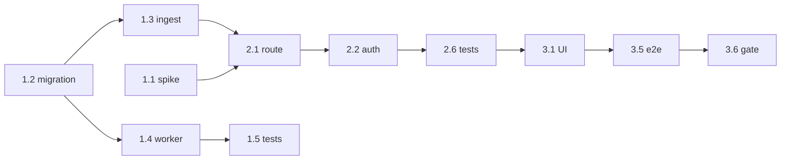

# 0002 Execution plan: JSON file upload and article versioning

## 1. Summary
Build an authenticated upload (`/upload` page, `POST /api/uploads`, `GET /api/uploads/:batchId`) that sends a JSON articles file through the existing validate, sanitise, insert and enrichment-queue path, returns a per-article report, and stores a changed re-submission as a new article version. **3 phases, about 34 to 46 hours** (phase 1: 12 to 16, phase 2: 12 to 16, phase 3: 10 to 14). Critical path: migration 0003 and functions, then the ingest refactor with worker version guard, then the route, then the UI. Estimates carry most uncertainty in the Next.js body handling (unknown) and the worker/version race tests.

## 2. Inputs
All eight specs of the feature plus ADRs 0019 to 0021 are present (list in front matter). Skipped by choice: carma-searchability (no new query: `articles` stays "current version", so search, facets and aggregates are unchanged). Not run (outside flow): carma-benchmark and carma-review, scheduled as gates below. Existing plan 0001 is the baseline; this plan adds work and changes nothing it already delivered.

## 3. Blockers and open questions
No hard blockers: the decisions that gate design are recorded (ADR 0019, 0020, 0021). The following are `UNCONFIRMED` defaults to be confirmed, none stops phase 1:
| # | Item | Owner | Default if unanswered | Needed by |
| --- | --- | --- | --- | --- |
| Q1 | Caps 5 MiB / 1000 items, depth 8 | simon | as stated | before task 2.2 |
| Q2 | Last-upload-wins ordering for versions (vs refuse older `published_at`) | simon | last wins | before task 1.2 |
| Q3 | Web `mem_limit` 512m, `/tmp` 64m | simon (after measurement 2.6) | 512m | phase 2 exit |
| Q4 | Per-token rate limit 10 per hour | simon | on | task 2.2 |
| Q5 | Pool timeouts 10 s / 15 s / 5 s, deadline 60 s | simon | as stated | task 2.1 |
| Q6 | SLO figures and alert thresholds in telemetry 0002 | simon | proposals | task 3.3 |
| Q7 | Show version history on the article page and trace route | simon | yes | task 3.2 |

## 4. Consistency report
| # | Finding | Class | Resolution |
| --- | --- | --- | --- |
| C1 | `status_snapshot()` (`db/migrations/0002_status_helpers.sql`) counts `open_jobs` as every state not in (`succeeded`, `skipped_no_content`, `dead`); the new `superseded_version` state would show as permanently "Processing" | Blocker for phase 1 exit | Task 1.2 replaces the function with `superseded_version` excluded; test added |
| C2 | Architect said the batch status read needs `SELECT` on `ingest_events` for `app_read`; DBA chose a SECURITY DEFINER function instead | Note | DBA 0002 wins; no direct grant (least privilege) |
| C3 | `loadArticles` returns counts only and overlaps `quarantined` with `errors` (`src/lib/ingest/ingest.ts:46-80`); the UI/API need a per-item list and disjoint outcomes | Blocker for phase 2 | Task 1.3 changes the return type, keeping the function pure (injectable pool and config) and the CLI output compatible |
| C4 | `ingestOne` returns only an outcome string; the report also needs article id, version and reason codes | Blocker for phase 2 | Task 1.3 |
| C5 | Worker claim and read path ignore versions (`src/worker/claim.ts`, `src/worker/loop.ts:122`); `app_worker` has no `UPDATE` right on `articles` so row locks are not available | Risk | Advisory lock plus version check (DBA 0002 section 8); task 1.4 |
| C6 | `src/worker/loop.ts` writes `articles.flags` for injection detection; a version swap replaces flags with the new ingest flags | Note | New text is re-scanned when its jobs run; confirm in test |
| C7 | `ALLOWED_LABEL_KEYS` in `src/lib/metrics.ts` rejects labels `reason`, `route`, `status_class`, `pool`, `query`, which telemetry 0001 and 0002 already assume (a runtime throw) | Blocker for phase 2 | Task 2.3 extends the list and adds a test that every catalogued label is allowed |
| C8 | Pino redaction lacks the upload token header/field | Risk | Task 2.3 |
| C9 | Article page queries `enrichment_jobs`/`enrichments` for all versions (`src/app/articles/[id]/page.tsx`); superseded jobs would look like failures | Risk | Task 3.2 filters by version |
| C10 | UX needs an upload-limits source (`/api/uploads/limits` or in-body) that no earlier spec defined | Gap | Task 2.4 adds `GET /api/uploads/limits` (read-only, from config) |
| C11 | Sanity spec lists reason codes (`unauthorized`, `file_too_large`, ...) not in `src/lib/reasons.ts` | Gap | Task 2.1 adds them; UX strings in 3.1 |
| C12 | ADR 0001 sized the build for the assignment; versioning (ADR 0021) adds a schema change and worker change | Principle note | Accepted by the user; contained by the "articles = current" design so no reader changes; recorded here |
| C13 | Next.js route handler body behaviour (buffering, size limits) in this version is unverified; AGENTS.md says APIs differ | Risk, unknown | Spike task 1.1 first; may adjust the streaming approach and memory number |
| C14 | Test plan requires the route to be callable without a running Next server; not guaranteed | Risk | Task 2.1 keeps logic in `src/lib/upload/*`; thin handler; fallback to Playwright for HTTP layer |
| C15 | Telemetry spec says `/api/metrics` is unauthenticated; new counters add no sensitive data | Note | Accept |
| C16 | `UPLOAD_MAX_BYTES` at 5 MiB vs web `mem_limit` 384m (current) | Risk | Raise to 512m in task 2.5, verify in 2.6 |
Coverage check: every FP/HP in the specs maps to a task and a test (section 7). No empty cells.

## 5. Dependency graph
| Task | Depends on |
| --- | --- |
| 1.1 Spike Next.js upload handling | none |
| 1.2 Migration 0003 | none |
| 1.3 Ingest refactor and versioning call | 1.2 |
| 1.4 Worker version guard | 1.2 |
| 1.5 Phase 1 tests | 1.3, 1.4 |
| 1.6 Gate: benchmark + review | 1.5 |
| 2.1 Upload library and route | 1.1, 1.3 |
| 2.2 Auth, limits, rate limit | 2.1 |
| 2.3 Metrics, labels, redaction | 2.1 |
| 2.4 Batch status and limits endpoints | 1.2, 2.1 |
| 2.5 Config, secrets, Compose | 2.1 |
| 2.6 Phase 2 tests and measurements | 2.2, 2.3, 2.4, 2.5 |
| 2.7 Gate: benchmark + review | 2.6 |
| 3.1 Upload page | 2.4 |
| 3.2 Article page versions | 1.2 |
| 3.3 Dashboards and alerts | 2.3 |
| 3.4 Compose deployment tests and README | 2.5, 3.1 |
| 3.5 e2e tests | 3.1 |
| 3.6 Final gate: benchmark + review, sign-off | 3.3, 3.4, 3.5, 3.2 |

Critical path: 1.2, 1.3, 2.1, 2.2, 2.6, 3.1, 3.5, 3.6. Parallel: 1.4 beside 1.3; 2.3/2.4/2.5 beside 2.2; 3.2 and 3.3 beside 3.1.

## 6. Phases

### Phase 1: Versioned ingest foundation (12 to 16 h)
Goal: a changed re-submission becomes a new version with correct enrichment handling, and ingest returns per-item results, all proven by tests, without any web change.
Entry: Q2 answered or default accepted.
Exit: tests I1 to I4, I6, FP-DB1 to DB3 and grants pass; sample file loads via the CLI exactly as before; status page does not count superseded jobs.
Rollback / safe stop: migration 0003 is additive; stopping here leaves ingestion and search working (versioning code path only triggers on a changed duplicate, which the CLI loader can also cause).
Human checkpoint: review the body of `ingest_new_version` (HP-DB1) and the lock ordering (FP-DB6).

**1.1 Spike: Next.js upload handling** (1 to 2 h, agent, depends on none)
- Why: C13, FP-D1, HP-D2. Steps: read `node_modules/next/dist/docs/01-app/01-getting-started/15-route-handlers.md` and the `route` file-convention page; write a throwaway route that reads `request.formData()` and the raw body with a byte counter; test a 6 MiB and 30 MiB body; measure RSS; record findings (does it buffer, any default limit, can `Content-Length` be trusted, streaming option) in `.specs/devops/0002` section 13 (edit in place).
- Where: scratch route removed afterwards. Acceptance: written answer to "how do we enforce UPLOAD_MAX_BYTES on bytes read", with measured RSS.

**1.2 Write migration 0003 and functions** (3 to 4 h, agent; human review of function)
- Why: ADR-0021, DBA 0002 sections 4, 8, 9, 10; C1. Steps: add `articles.version`, `updated_at`; create `article_versions`; add `ingest_events.article_version`, `enrichment_jobs.article_version`, `enrichments.article_version`; swap job unique key and state CHECK (`superseded_version`); create `ingest_new_version(...)` and `upload_batch_status(uuid)` (SECURITY DEFINER, `search_path`, REVOKE PUBLIC); grants (EXECUTE to `app_ingest`/`app_read`, `SELECT article_versions` to `app_read`); replace `status_snapshot()` excluding `superseded_version` from `open_jobs`; rollback notes in header.
- Where: `db/migrations/0003_article_versions.sql`. Inputs: DBA 0002. Outputs: migration applies on fresh and on existing 0002 database, twice.
- Acceptance: DBA E1 to E4, E7, E8 (rehearsal); `grants.test.ts`; `status_snapshot` test with a superseded job.

**1.3 Refactor ingest for per-item results and versioning** (3 to 4 h, agent, depends 1.2)
- Why: C3, C4, ADR-0021, FP-D4, FP-12. Steps: `ingestOne` returns `{outcome, reasonCodes, articleId, articleVersion}`; on `(source, external_id)` conflict compare `content_hash`: equal means `duplicate`, different calls `ingest_new_version` and returns `admitted` with reason `new_version`; `loadArticles` returns `{received, admitted, duplicate, quarantined, versions, items[], batchId, reconciled}` (no overlapping `errors` in the disjoint totals; keep an `errors` field for the CLI only if still used); CLI output unchanged; add `new_version` etc. to `src/lib/reasons.ts`.
- Where: `src/lib/ingest/ingest.ts`, `src/cli/load.ts`, `src/lib/reasons.ts`. Acceptance: I1, I2, I3, I8, FP-12 tests; existing `tests/integration/ingest.test.ts` still passes.

**1.4 Add worker version guard** (2 to 3 h, agent, depends 1.2)
- Why: C5, FP-DB2, FP-DB3. Steps: claim returns `article_version`; `processJob` reads `version` with the text; at finish take `pg_advisory_xact_lock(hashtext('article'), article_id)`, re-read version, discard and mark `superseded_version` if different; write `article_version` on `enrichments`; release reserved budget for superseded jobs (sweeper/finish).
- Where: `src/worker/claim.ts`, `src/worker/loop.ts`, `src/worker/finish.ts`, `src/worker/sweeper.ts`, `src/worker/budget.ts`. Acceptance: `version-worker-race.test.ts`, `version-budget.test.ts`.

**1.5 Phase 1 tests** (2 to 3 h, agent) — `upload-conservation`, `upload-idempotent`, `upload-version`, `upload-version-search`, `upload-fidelity`, `version-atomic`, `grants`, harness additions (`tests/harness/upload.ts`, fixtures, shared reconcile `afterEach`). Acceptance: all green in the integration suite under 2 minutes added.

**1.6 Gate: benchmark and review** (1 h, human triggers, agent runs) — run carma-benchmark for HP-1/HP-DB1 (1000 items, 1000 versions, conservation) and carma-review against this plan; findings fixed before phase 2.

### Phase 2: Upload API, config and telemetry (12 to 16 h)
Goal: an authenticated `POST /api/uploads` that is safe, bounded and observable, with batch status and limits endpoints, running in Compose.
Entry: phase 1 exit; Q1, Q4, Q5 answered or defaults accepted.
Exit: gate, auth, encoding, fault, reconcile and grants tests pass; smoke upload in Compose reconciles; memory measured against Q3.
Rollback / safe stop: `UPLOAD_ENABLED=false` returns 503 and the rest of the app is unaffected.
Human checkpoint: confirm limits after memory/time measurement; review the gate code for the byte-count enforcement.

**2.1 Upload library and route handler** (3 to 4 h, agent, depends 1.1, 1.3)
- Why: ADR-0019, sanity 0002 section 3, FP-1..3, FP-D1, FP-D7. Steps: `src/lib/upload/` with `gate` (content type, bytes counted while reading, strict UTF-8 via `TextDecoder({fatal:true})`, BOM strip, array check, count and depth), `run` (calls `loadArticles` with the ingest pool, overall deadline, in-flight semaphore, maps connection errors to 503, reconcile check), `POST /api/uploads/route.ts` thin; ingest pool = `createPool(..., "web-ingest")` with connection options for timeouts; add new reason codes.
- Where: `src/lib/upload/*`, `src/app/api/uploads/route.ts`, `src/lib/db/pool.ts`, `src/lib/reasons.ts`. Acceptance: gate unit tests, FP-1, FP-2, FP-3, FP-4, FP-D3, FP-D7, FP-12 tests.

**2.2 Token auth, rate limit, kill switch** (2 h, agent, depends 2.1) — constant-time compare, auth before reading body, 401/429/503 mapping, per-token counter, `UPLOAD_ENABLED`, missing-token behaviour (`upload_disabled`). Acceptance: `upload-auth.test.ts`, FP-9.

**2.3 Metrics, labels and redaction** (1.5 to 2 h, agent, depends 2.1) — extend `ALLOWED_LABEL_KEYS` (C7) with a test iterating the catalogue; add `mss_upload_*` metrics, event-loop lag sampler; extend pino redaction (C8). Acceptance: `/api/metrics` shows the series; log capture test shows no token.

**2.4 Batch status and limits endpoints** (1.5 h, agent, depends 1.2, 2.1) — `GET /api/uploads/:batchId` (UUID validated, read pool, calls `upload_batch_status`, 404 for unknown) and `GET /api/uploads/limits`. Acceptance: DBA E6 plan check; endpoint tests.

**2.5 Config, secrets and Compose** (2 h, agent, depends 2.1) — `src/lib/config.ts` new settings and validation; `ops/init-secrets.sh` upload token and copy to `web`; `compose.yaml`/`compose.dev.yaml` env, `mem_limit: 512m`, `/tmp` size; `.env.example`; upload health in `/api/status`. Acceptance: devops tests "clean bring-up", "missing token", "config validation".

**2.6 Phase 2 tests and measurements** (2 to 3 h, agent) — `upload-gate`, `upload-auth`, `upload-encoding`, `upload-fault`, `upload-sanity`, `upload-reconcile`, `upload-budget`; measurements for HP-1, HP-2 (items/s, event-loop lag, RSS at cap). Acceptance: section 5 thresholds recorded in `reports/json-file-upload/`; Q3 settled.

**2.7 Gate: benchmark and review** (1 h) — carma-benchmark HP-1/HP-D1 through the HTTP route; carma-review against specs and secrets-leak check.

### Phase 3: UI, article versions, dashboards and release checks (10 to 14 h)
Goal: operators can upload and follow a batch in the UI, see versions, and the whole feature deploys and is observable from a clean `docker compose up`.
Entry: phase 2 exit.
Exit: e2e upload and rejection tests pass; Compose deployment tests pass; dashboards and alerts load; README updated.
Rollback / safe stop: UI is additive; hide the nav link or set `UPLOAD_ENABLED=false`.
Human checkpoint: review the page against the wireframe brief; accept or log SHOULD-tier gaps.

**3.1 Build the upload page** (4 to 5 h, agent, depends 2.4) — `/upload` with `UploadForm`, `BatchSummary`, `EnrichmentProgress`, `BatchTable`, polling, error states, reason text in `src/lib/ui/strings.ts`, nav link in `AppHeader`; `?batch=` loading. Acceptance: UX 0002 section 5 states; keyboard and a11y checks; RTL-safe display of ids.

**3.2 Version history on the article page and trace route** (1.5 to 2 h, agent, depends 1.2) — filter jobs/enrichments by current version (C9), `VersionList` with read-only older text, trace route includes versions. Acceptance: I10 via the page data function; manual check of a versioned article.

**3.3 Dashboards and alerts** (1.5 to 2 h, agent, depends 2.3) — `ops/alerts.yml` U1 to U5, Grafana "Uploads" row; confirm Prometheus scrapes web. Acceptance: rules validate (`promtool` or the existing check), dashboard provisions on start.

**3.4 Compose deployment tests and README** (2 h, either, depends 2.5, 3.1) — run devops section 9 suite; README "Uploading articles" (token retrieval, limits, rollback note), ADR links. Acceptance: all deployment tests green or gaps listed.

**3.5 End-to-end tests** (1.5 to 2 h, agent, depends 3.1) — `tests/e2e/upload.spec.ts` happy and rejection paths; XSS render check. Acceptance: pass.

**3.6 Final gate and sign-off** (1 h, human) — carma-benchmark + carma-review one last time; update spec statuses to `approved`; record any accepted gaps.

## 7. Traceability matrix
| Requirement / risk | Task | Test or measurement |
| --- | --- | --- |
| F1 upload file (UI + API) | 2.1, 3.1 | smoke upload, e2e |
| F2 same pipeline | 1.3, 2.1 | I1, I6 |
| F3 per-article report | 1.3, 2.1 | I1, FP-D4 |
| F4 enrichment progress | 2.4, 3.1 | E6, e2e |
| N1 no silent loss, FP-3, FP-12 | 1.3, 2.1 | I1, reconcile test |
| N2 idempotent, FP-6 | 1.3 | I2 |
| N3 budget, FP-7, FP-D6 | 2.1, 2.2 | upload-budget |
| ADR-0021 versions, FP-D5, FP-DB1, DB4 | 1.2, 1.3 | I3, I4, version-atomic |
| FP-DB2, DB3, DB6 | 1.4 | race, budget, lock tests |
| FP-1, FP-2, FP-D1, FP-D3, FP-D7 | 2.1 | upload-gate, upload-encoding |
| FP-4, FP-5 | 2.1 | upload-fault |
| FP-8, HP-D1 | 2.1, 2.3 | mixed search/upload run, lag metric |
| FP-9, FP-D2 | 2.2, 2.3 | upload-auth, log capture |
| FP-10 | 2.1 | upload-sanity |
| FP-11 | 1.3 | batch-kind test |
| FP-V1..V5 | 2.5, 3.4 | deployment suite |
| HP-1, HP-D1, HP-DB1 | 1.6, 2.6, 2.7 | benchmark, measurements |
| HP-2, HP-D2 | 1.1, 2.6 | RSS at cap |
| HP-3, HP-DB2 | 2.4 | EXPLAIN check |
| Telemetry U1-U5 | 2.3, 3.3 | rules validate; mismatch test |
| UX states | 3.1, 3.2, 3.5 | e2e, manual |
| C1 status open_jobs | 1.2 | status_snapshot test |
| C7 label allow-list | 2.3 | catalogue test |

## 8. Risks and assumptions
- Estimates: 34 to 46 h; widest uncertainty in 1.4/1.5 (concurrency tests) and 2.1 (Next body handling).
- Versioning widens scope beyond ADR 0001 (C12); mitigated by keeping readers unchanged. If time is short, the cut line is: ship phases 1 to 2 and a minimal page, deferring 3.2 and 3.3.
- Web gains write credentials (ADR-0019); mitigations: route-only pool, token, loopback bind by default.
- Last-upload-wins can replace newer text with older text (Q2).
- Assumed: Postgres 16.6, single Compose host, synthetic test data, mock provider in tests.

## 9. Execution notes
Work tasks in dependency order; mark each done only when its acceptance check passes. If an assumption fails (for example Next buffers whole bodies or the function exceeds 30 ms per version), stop and raise it; do not change the design silently. Return to carma-dba if versioning performance or locking breaks, to carma-architect if the sync model cannot meet the deadline at the caps (the alternative on record is stage-then-worker, ADR-0019 option 2). Before coding, read the relevant pages under `node_modules/next/dist/docs/` as AGENTS.md requires. Record new binding decisions as ADRs (next number 0022).
