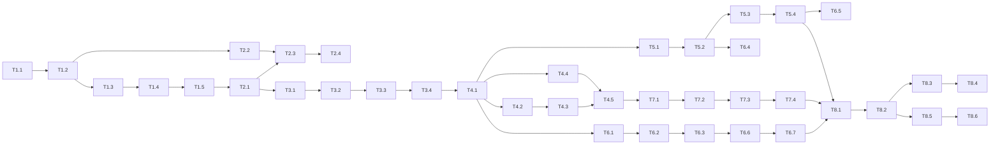

# 0003 Execution plan for article translation

## 1. Summary
Build: for non-English articles, translate headline and body to English at ingest through a third enrichment part, show the translation by default with a "Show original" toggle, and make search match both texts. Eight phases, about 90 to 120 hours in total (large uncertainty in the worker and UI phases, section 8). Critical path: schema (P1) → enqueue (P2) → worker lane core (P3) → save, cache and budget (P4) → UI (P6) → hardening (P8). Search (P5) and telemetry (P7) can run in parallel after P4's save path exists.

## 2. Inputs
All eight article-translation specs and ADR-0022 to ADR-0028 listed in the front matter are present and read; earlier plans 0001 and 0002 were used only for conventions. No spec is missing: searchability, data-sanity, DBA, telemetry, UX, devops and testing all ran. Nothing was skipped by choice. `AGENTS.md` applies to every task that touches Next.js code: read the relevant guide in `node_modules/next/dist/docs/` first (route handlers, client components, server components), because this Next version differs from common knowledge.

## 3. Blockers and open questions
| ID | Item | Blocks | Owner | Options |
| --- | --- | --- | --- | --- |
| B1 | OpenAI model id and prices are still unset (ADR-0003). Real-mode cost cap, the real-model sample (testing 0003 FP-D2/D3 calibration) and the budget cap cannot be finalised | T8.3, T8.4; not P1 to P7 (the mock path works) | User | Supply `OPENAI_MODEL` and prices; or accept mock-only verification and finish T8.3 later |
| B2 (resolved: ADR-0029, additive, total up to 13) | Translate budget: devops 0003 adds a separate ledger key `openai-translate` with its own cap (default 3), sanitization 0003 and ADR-0023 call it "a share of the OpenAI budget". Separate keys make total OpenAI spend = 10 + 3 unless the existing cap is lowered | T1.3 (defaults), T4.3 | User | (a) additive: total ceiling 13 per day; (b) carve-out: `BUDGET_OPENAI_DAILY` 7 + translate 3 = 10; (c) one shared key (translation can starve summaries; rejected by FP-8) |
| B3 | The telemetry specs treat many series as "existing" that the code does not emit (section 4, C2). Scope of P7 depends on this | T7.1 | User or lead | (a) implement the baseline set needed by the translation alerts only (planned); (b) implement all of telemetry 0001 first (separate feature) |
| B4 | Target hardware unknown (carried over from devops 0001/0002) | T8.5 capacity runs only | User | Provide specs; or run on a dev machine and label results |
Open but not blocking (defaults taken, listed as risks): reveal-beacon build-or-skip (default build, T6.7 is last and can be dropped), sticky toggle (default no), superseded-translation retention 30 days, log sampling of `translation.accepted`, SLO numbers, chunk size, max chunks and ratio bounds, whether `trgm_index` is on in the target database.
FP-V1 (translating every foreign article is infeasible at the 800/s target) is a recorded risk, not a blocker; ADR-0022 should be revisited as hybrid before any scale-up.

## 4. Consistency report
Cross-checked against the spec text and the code.
| ID | Finding | Class | Resolution |
| --- | --- | --- | --- |
| C1 | Devops 0003 says web readiness checks `/api/health`; the code has `/api/healthz` and `/api/readyz` (`src/app/api/readyz/route.ts`, which checks `schema_migrations`) | Note | Extend `readyz` to check `to_regclass('article_translations')`; use the real route names in docs (T6.8) |
| C2 | Telemetry 0003 reuses "existing" series (`mss_jobs`, `mss_job_outcomes_total`, `mss_job_oldest_age_seconds`, `mss_time_to_enriched_seconds`, `mss_budget_deferred_total`, `mss_prompt_injection_suspected_total`, `mss_db_query_duration_seconds`, `mss_http_request_duration_seconds`, `mss_search_duration_seconds`, `mss_breaker_state`, `mss_llm_cost_micro_total`, `mss_provider_duration_seconds`, `mss_ingest_duration_seconds`). The code emits only upload series, `mss_event_loop_lag_seconds`, `mss_worker_heartbeat_unixtime` and build info; `ops/alerts.yml` already references `mss_jobs_queued` and `mss_job_oldest_age_seconds`, which nothing emits | Blocker for P7 scope (B3) | T7.1 implements the minimal baseline (job gauges per `part`/`state`, outcome counter, provider duration, budget deferrals, breaker state) the translation alerts rely on |
| C3 | Telemetry T-SLI-1 uses `translation job succeeded_at`; `enrichment_jobs` has no such column, and `articles.ingested_at` stays the first arrival for later versions (DBA 0002) | Risk | Define lag as `article_translations.created_at − (CASE WHEN version = 1 THEN ingested_at ELSE updated_at END)`; no schema change (T7.2) |
| C4 | Untranslated count: telemetry `mss_search_foreign_untranslated` is global and refreshed every 60 s; the UX note and search spec need the count for the current selection | Note | Two different things. Keep the gauge; compute the per-request count in the search query (T5.4) |
| C5 | Reason codes differ by spec: sanitization `out_echo`, `out_wrong_lang`…; telemetry labels `echo`, `wrong_lang`…; UX copy covers three failure messages while telemetry lists `attempts` and `budget_never` as dead reasons with no copy | Risk | One enum in code (`src/lib/translate/reasons.ts`, T1.2) mapping job reason, metric label and UI copy key; add copy for `attempts` ("Translation unavailable: the service kept failing") and `budget_never` |
| C6 | Sanitization 0003 section 9 says validated chunks are cached in the job's raw output / `origin=cache`; DBA 0003 creates `translation_chunk_cache` | Note | DBA table governs; `origin='cache'` only labels metrics/rows produced from cache hits (T4.2) |
| C7 | `enrichments.raw_output jsonb` would store the full model response for translation, duplicating the entire translated text and putting article text in a second place | Risk | For `translation`, store only `{usage, model_reported, chunk_count}` in `raw_output` (T4.1); sanitization says logs never hold text, this extends it to the DB |
| C8 | Worker pool max is 6 (`src/lib/db/pool.ts:16`); the claim loop holds one pooled client across provider calls (`src/worker/loop.ts`) | Risk | Release the claim client right after COMMIT (T3.1), then set pool max to lanes + 2 (T3.1) |
| C9 | NOT semantics: ADR-0027 (original side only) replaced the default in search 0002, DBA 0003 and UX 0003; testing 0003 updated; no remaining text checked contradicts it | Note | Verified after the patch; test row in testing 0003 section 8.3 |
| C10 | ADR-0027 builds a trigram index on translations, but `articles_trgm_idx` creation is guarded by a `trgm_index` flag (can be `off`) (`0001_init.sql:179-188`) | Risk | Migration guards the same way; compiler reads the flag and still works (sequential ILIKE) when off (T1.4, T5.1) |
| C11 | ADR-0028 (no backfill) means after release every older foreign article counts as "not translated"; the UX note turns warn-style above 5% and would be permanently alarming | Risk | Count and label "older articles, not scheduled" as a separate reason that does not trigger the warn style (T5.4, T6.5) |
| C12 | Mock translation must pass the output validators (language check for Latin-script sources uses an English stop-word ratio; ratio bounds; paragraph count) | Risk | Mock builds output from common English words in the right paragraph structure with `[mock translation]` prefix, verified by running the validators in a unit test (T3.4) |
| C13 | `isEnglish` rule: spec says `en`/`en-*`; real data may carry `EN`, `en_US`, `eng` | Note | Normalise case, split on `-`/`_`, accept primary tag `en` or `eng`; unknown/empty stays "needs translation" (T1.2). The decision is passed from TypeScript to SQL as a boolean so the rule exists once |
| C14 | Migration numbering `0004`, enqueue statement count (three jobs in one multi-row INSERT), route name `/api/telemetry/translation-view` and label keys `script`, `view` (must be added to `ALLOWED_LABEL_KEYS` and `tests/unit/metrics-labels.test.ts`) agree across DBA, devops, telemetry, testing | Note | Verified; T1.3/T7.3 carry the label allow-list change |
| C15 | `ingest_new_version` signature change breaks an old web image that still calls the old signature; web and worker must deploy together | Risk | Drop the old overload; deploy both images in one `docker compose up -d`; rollback instructions in devops 0003 section 7 (T2.1, T8.6) |
| C16 | UX says both texts are in the HTML and JS-disabled fallback is undecided (testing 0003 lists it as a gap) | Note | Default: server HTML shows the translation and puts the original in a collapsed `
`; the client component takes over after hydration (T6.2) |
| C17 | No CI exists, so the MUST tier (testing 0003 section 10) has no runner | Risk | Optional task T8.7 adds a minimal workflow; a human decides |
| C18 | FP coverage gaps: FP-9 (language mislabel) and FP-V1 (scale) have no automated test | Note | Accepted (testing 0003 section 12); manual sample in T8.4 |
| C19 | Principle check: nothing here trades P3, P2 or P6 to P8 for speed. The one P3 cost is that English search misses foreign articles until translated, which the UI states (UX section 6) | Note | Recorded; no extra decision needed |

## 5. Dependency graph

Critical path: T1.1 → T1.4 → T2.1 → T3.1 to T3.4 → T4.1 → T6.1 → T6.3 → T6.7 → T8.1 to T8.6. Parallel tracks after T4.1: search (P5, needs compiler knowledge), UI (P6, needs a data shape), telemetry (P7). P5 and P6 touch different files except `ArticleCard.tsx` and the search route (T5.2 before T6.4).
Gates: after P2, P4 and P5 run carma-benchmark (HP-1, HP-S1) and carma-review before the next phase starts (agent runs benchmark; a human reads the plan comparison in T5.3).

## 6. Phases

### Phase 1: Decisions, helpers, configuration and schema (≈10 to 14 h)
Goal: the database has the translation schema and the code has configuration and shared helpers, with nothing yet enqueued.
Entry: B2 resolved (ADR-0029). 
Exit: `0004` applies cleanly on an empty database and on a populated one, re-applies safely, rollback dry-run works; config validates; unit tests for helpers pass.
Rollback/safe-stop: nothing behaves differently until P2; dropping the new tables restores the old state.
Human checkpoints: T1.1 (decision), review of the migration (T1.4).

**T1.1 Confirm B2 is recorded.** Why: ADR-0010, spend control (P2). Steps: B2 was decided as additive (ADR-0029); check the defaults in T1.3 match (`BUDGET_OPENAI_DAILY` 10, `BUDGET_TRANSLATE_DAILY` 3). Where: `.specs/architect/adrs/0029-additive-translate-budget-cap.md`. Accept: ADR present and config defaults agree. Estimate: 0.25 to 0.5 h. Depends: none. Owner: agent. Specs: devops 0003 s6, sanitization 0003 s9.

**T1.2 Add shared translation helpers.** Why: single source of truth for the language rule and reason codes (C5, C13). Steps: create `src/lib/translate/language.ts` (`isEnglish`, `needsTranslation`), `src/lib/translate/reasons.ts` (enum with job reason, metric label, UI copy key), types for the translation part; extend `src/lib/reasons.ts` if it already holds reason codes (read it first). Where: `src/lib/translate/*`, `tests/unit/translate-language.test.ts`. Accept: table tests for `en`, `EN`, `en-GB`, `en_US`, `eng`, `ar`, `zh-Hans`, empty, null, `"N/A"`; reasons enum covers all sanitization and telemetry codes. Estimate: 1.5 to 2.5 h. Depends: T1.1. Owner: agent. Specs: search/sanitization 0003 s3, UX s5.

**T1.3 Add configuration.** Why: devops 0003 s6. Steps: add the variables to the zod schema in `src/lib/config.ts` with ranges (`TRANSLATE_RATIO_*` parsed from "min,max", min < max), add to the typed config object, `.env.example`, `compose.yaml` worker env (and `compose.dev.yaml` if it duplicates env), `docs/environment.md`; add `script` and `view` to `ALLOWED_LABEL_KEYS` and update `tests/unit/metrics-labels.test.ts` and `tests/unit/config.test.ts`. Where: `src/lib/config.ts`, `src/lib/metrics.ts`, `.env.example`, `compose*.yaml`, `docs/environment.md`. Accept: bad values fail with the variable name; defaults match devops 0003 s6; `ENRICHMENT_MODE=real` without a key still fails fast. Estimate: 1.5 to 2.5 h. Depends: T1.2. Owner: agent.

**T1.4 Write migration `0004_article_translations.sql`.** Why: DBA 0003 s4, s7, s10. Steps: (1) drop and re-add the two `part` CHECKs, looking constraint names up in `pg_constraint`, using `NOT VALID` then `VALIDATE`; (2) create `article_translations` with the columns in DBA 0003 s4 (no confidence columns), the CHECK `at_has_text`, `fillfactor 90`, autovacuum settings; (3) partial unique index `article_translations_current_uq`, partial GIN on `search_vector`, partial trigram GIN guarded by the `trgm_index` flag (same pattern as `0001_init.sql:179-188`), built `CONCURRENTLY` is not possible inside the migration transaction, so create it with the table (empty); (4) `translation_chunk_cache`; (5) grants from DBA 0003 s10 (app_read SELECT on `article_translations`, app_worker SELECT/INSERT plus `UPDATE (superseded_at)`, cache table to app_worker only); (6) seed `system_flags` `translation_enabled` from the setting in `src/cli/migrate.ts` next to `enrichment_enabled`; (7) write the manual rollback as a comment block at the top like `0003`. Where: `db/migrations/0004_article_translations.sql`, `src/cli/migrate.ts`. Accept: applies on an empty database and on a database at `0003` with data; second run is a no-op; `\d` shows the indexes; grants verified by attempting forbidden writes as each role. Estimate: 3 to 4 h. Depends: T1.3. Owner: agent, human review (migration review). Specs: DBA 0003 s4, s7, s10; devops s5.

**T1.5 Test the migration.** Why: FP-DB3, FP-DB6. Steps: integration test applying `0003` then `0004` on a seeded database; check constraints, indexes, grants per role, idempotent re-run; a test that the migration file contains no non-concurrent index creation on existing populated tables (static grep); measure the constraint swap with 1M job rows (run once, record the lock time, `tests/integration/migration-0004.test.ts`). Accept: lock time under 1 s at 1M rows. Estimate: 2.5 to 3.5 h. Depends: T1.4. Owner: agent. Specs: testing 0003 FP-DB3, devops s9.

### Phase 2: Enqueue on ingest and test fixtures (≈10 to 14 h)
Goal: every non-English article (new or re-versioned) gets exactly one translation job; ingest throughput is unchanged.
Entry: P1 exit.
Exit: I1 (enqueue half), I4, FP-1 and FP-DB1 tests pass; HP-1 benchmark within 5%; carma-review done.
Rollback/safe-stop: jobs just sit queued with no worker lane; turn off by not deploying P3 or by `translation_enabled=false`.
Human checkpoint: review of the changed hot path (architect HP-1).

**T2.1 Change the enqueue in `ingestOne` and `ingest_new_version`.** Why: ADR-0022, DBA 0003 s4. Steps: in `src/lib/ingest/ingest.ts` (around line 525) replace the per-part loop with one multi-row INSERT building the rows `sentiment`, `summary_topics` and, when `needsTranslation(language)` and there is text, `translation` (`skipped_no_content` state when no text, same rule as today); in a new migration step inside `0004` (or a function-replace block at its end) `CREATE OR REPLACE` `ingest_new_version` with the new parameter `p_needs_translation boolean`, which supersedes the current translation row and inserts the new job; drop the old overload and re-grant EXECUTE with the full argument list; update the TypeScript caller. Where: `src/lib/ingest/ingest.ts`, `db/migrations/0004_*.sql`. Accept: statements per admitted article do not increase; both paths covered by tests; `\df` shows one overload. Estimate: 3 to 4 h. Depends: T1.5, T1.2. Owner: agent, human review. Specs: DBA 0003 s4, FP-1, FP-DB1, HP-1.

**T2.2 Build fakes and fixtures.** Why: testing 0003 s2, s7. Steps: `tests/fakes/translator.ts` (modes listed in testing 0003 s2, records calls per chunk), `tests/fixtures/translation.ts` (ar, zh, fr, en, unknown, mixed, long 1/20/21 chunks, injection, no headline, no body), extend `tests/fixtures/articles.ts` only if needed. Accept: fixtures load through `loadArticles`; the fake's modes are unit-tested. Estimate: 2 to 3 h. Depends: T1.2. Owner: agent.

**T2.3 Write enqueue integration tests.** Why: I1 (enqueue part), I2, I4, I11, FP-1, FP-DB1. Steps: tests for each language row, new version path with and without the flag, duplicate ingest, old overload absent, `skipped_no_content`, reconciliation query (the telemetry T4 query as a SQL helper `tests/harness/translation-ledger.ts`). Where: `tests/integration/translation-enqueue.test.ts`. Accept: all green against a real Postgres. Estimate: 3 to 4 h. Depends: T2.1, T2.2. Owner: agent.

**T2.4 Benchmark and review gate.** Why: HP-1/HP-DB1, ADR-0022 cost. Steps: add `--foreign-share` to `.benchmarks/article-ingest/bench.mjs`; run 100,000 articles at 0% and 30% foreign (carma-benchmark); run carma-review on the diff; record results under `reports/`. Accept: rows/s with 30% foreign within 5% of 0%; review has no blocker. Estimate: 2 to 3 h. Depends: T2.3. Owner: agent runs, human reads. 

### Phase 3: Worker lane core (≈13 to 16 h)
Goal: the worker can translate one article correctly (chunk, call provider or mock, validate), without yet saving.
Entry: P2 exit. Read `src/worker/*` fully first.
Exit: unit tests for chunker, validators, mock and provider adapter pass; claim connection fix in place.
Rollback/safe-stop: lane disabled by default flag until P4.
Human checkpoint: T3.3 regex review (HP-D1).

**T3.1 Unify the part type, free the claim connection, size the pool.** Why: C8, FP-V3. Steps: introduce `type EnrichmentPart = "sentiment" | "summary_topics" | "translation"` and use it in `claim.ts`, `finish.ts`, `loop.ts`; in `loop.ts` release the claim `client` immediately after `COMMIT` and before processing jobs; extend the part loop with a `translation` lane with its own breaker (`openai-translate`), concurrency, RPM and the `translation_enabled` flag check; set worker pool max to `jev + openai + translate concurrency + 2` (`src/lib/db/pool.ts`). Where: `src/worker/*.ts`, `src/lib/db/pool.ts`. Accept: existing worker tests still pass; new test shows no connection held during a 5 s fake call. Estimate: 3 to 4 h. Depends: T2.1. Owner: agent, human review.

**T3.2 Write the chunker and the translation prompt.** Why: ADR-0023, sanitization s5, s8. Steps: `src/lib/translate/chunk.ts` (paragraph split, sentence split for long paragraphs, grapheme-safe last resort, chunk size from config, count cap → `too_long`); `src/lib/translate/prompt.ts` (nonce fence reused from `src/lib/enrich/prompt.ts`, system prompt: translate only, leave names and numbers, plain text, JSON `{translation, detected_language}`, one output paragraph per input paragraph); strip bidi override and zero-width characters from the model input and record the transformation. Accept: property test I5 (paragraph count and order); fixtures with surrogate pairs, combining marks, 50,000-character paragraph. Estimate: 3 to 4 h. Depends: T3.1. Owner: agent.

**T3.3 Write the output validators.** Why: sanitization s4, FP-4, FP-D2, FP-D3, FP-5. Steps: `src/lib/translate/validate.ts` with the seven checks in the specified order, linear-time (no regex that can backtrack; use character scans like `src/lib/search/scan.ts`), thresholds from config, reason codes from T1.2; reuse `detectInjection` for check 7. Accept: unit tests for every fake mode; microbenchmark under 50 ms per 100 KB for ar, zh, en (HP-D1). Estimate: 3 to 4 h. Depends: T3.2. Owner: agent; human reviews the patterns and thresholds.

**T3.4 Add the OpenAI translate adapter and the mock.** Why: ADR-0023, ADR-0013, C12. Steps: add `translate()` to `EnrichmentProviders` in `src/lib/providers/types.ts`; OpenAI adapter in `openai.ts` (structured output, per-chunk timeout, status errors as in the existing adapter so `classifyProviderError` works; `usage` returned); mock adapter in `mock.ts` (labelled `[mock translation]`, English stop-word-based paragraphs, optional fixture lexicon for the sample articles, `origin: "mock"`, cost 0); update `createProviders` mode logic for the `translate` part; update `tests/fakes/providers.ts`. Accept: mock output passes the validators for ar/zh/fr fixtures; real mode without key fails fast; adapter tested against a local stub server for 200/429/500/malformed. Estimate: 3.5 to 5 h. Depends: T3.3. Owner: agent. Specs: devops s6 mock section.

### Phase 4: Save path, cache, budget and fault handling (≈11 to 15 h)
Goal: an article is translated end to end and the result is stored safely.
Entry: P3 exit.
Exit: I1 to I10 pass; budget, breaker, kill switch and crash tests pass; carma-review done.
Rollback/safe-stop: kill switch `translation_enabled=false`.
Human checkpoint: T4.1 save-transaction review (concurrency).

**T4.1 Implement the save transaction.** Why: FP-6, FP-DB2, DBA 0003 s8, C7. Steps: `finishTranslation` in `src/worker/finish.ts`: begin; take `pg_advisory_xact_lock(hashtext('article'), article_id)`; re-check `articles.version`; if changed mark job `superseded_version` and stop; supersede any current translation; insert `enrichments` (`part='translation'`, `raw_output = {usage, model_reported, chunk_count}` only, trust `low` when the injection flag was set); insert `article_translations` with `search_text` from the shared normaliser (`src/lib/normalise`, `search_text_ver`); mark job `succeeded`; delete cache rows; commit. Treat a unique-index conflict as already done only when the stored `enrichment_id`/version match. Where: `src/worker/finish.ts`, `src/worker/loop.ts`. Accept: tests I2, I3, I4, I7, I8, I9, I10 pass, including the 50x50 concurrency repetition. Estimate: 3.5 to 5 h. Depends: T3.4. Owner: agent, human review.

**T4.2 Implement the chunk cache and the job runner.** Why: I6, FP-D4. Steps: `processTranslationJob` in `loop.ts`: reserve the budget for all chunks up front; for each chunk check `translation_chunk_cache` by `(job_id, chunk_idx, input_hash)`; call provider; validate; write the cache row in its own small transaction; join; validate whole; save; release the reservation on failure. Failure classes via `classifyProviderError` and `maxAttemptsFor`; invalid output has 2 attempts; `too_long` is dead immediately. Accept: `fail_on_chunk(7)` retry calls only chunks 7..n and ends with the same text hash as a clean run. Estimate: 3 to 4 h. Depends: T4.1. Owner: agent.

**T4.3 Wire the budget ledger key and the breaker.** Why: B2/T1.1, FP-8, FP-V5. Steps: `ensureBudgetDay` for provider key `openai-translate` with `BUDGET_TRANSLATE_DAILY` (or the chosen carve-out); translation jobs reserve/settle against that key and go `deferred_budget` when exhausted; breaker state written via `worker_set_flag('breaker.openai-translate', …)`; the StatusPage shows the new breaker (it filters `breaker.*` already). Accept: exhausting the translate cap leaves sentiment/summary lanes unaffected; fake clock moves to the next UTC day and jobs resume; breaker opens/half-opens per `tests/unit/breaker.test.ts` semantics. Estimate: 2 to 3 h. Depends: T4.1. Owner: agent.

**T4.4 Extend the sweeper and the kill switch.** Why: FP-DB5, ADR-0022. Steps: `sweepExpired` also purges cache rows older than `TRANSLATE_CACHE_DAYS` after a terminal job, deletes superseded translations older than `TRANSLATE_SUPERSEDED_DAYS`; `translation_enabled` flag read each loop; status snapshot exposes translation job counts. Accept: sweeper tests with the fake clock; flag off stops claims, flag on drains. Estimate: 1.5 to 2.5 h. Depends: T4.1. Owner: agent.

**T4.5 Write worker integration and fault tests, then gate.** Why: testing 0003 s4, s8.1. Steps: tests for each fake mode (dead reasons), 20 vs 21 chunks, timeout/429/5xx/400/401, injection path with `trust='low'`, kill switch, crash mid-article (spawn the worker loop in-process and abort), bulkhead (translation outage does not slow summaries). Run carma-review. Accept: all green; reconciliation I1 holds after each scenario. Estimate: 3 to 4 h. Depends: T4.2, T4.3, T4.4. Owner: agent.

### Phase 5: Search over both texts (≈10 to 14 h) — parallel with P6, P7
Goal: search matches original and translated text, reports which side matched, and tells the truth about untranslated articles.
Entry: T4.1 done (table is written by the worker). Read `src/lib/search/compile.ts`, `run.ts`, `echo.ts`, `filters.ts` first.
Exit: search tests (testing 0003 s8.3) pass; existing search tests unchanged and green; plan experiment decided.
Rollback/safe-stop: the compiler change is behind the existing query path; revert restores original-only search.
Human checkpoint: T5.3 plan decision.

**T5.1 Extend the AST compiler.** Why: ADR-0025, ADR-0027, FP-S1. Steps: in `compileAst` wrap each term leaf as original OR EXISTS on the current translation (`t.article_version = a.version AND t.superseded_at IS NULL`); FTS leaves use `t.search_vector`; substring leaves use `t.search_text ILIKE` (works without the trigram index, slower, when `trgm_index` is off); the right side of `and_not` compiles against the original side only; keep parameters numbered and reused. Where: `src/lib/search/compile.ts`. Accept: unit tests per operator (term, phrase, wildcard, AND, OR, NOT) with expected SQL shape and parameters. Estimate: 3 to 4 h. Depends: T4.1. Owner: agent.

**T5.2 Return `matched_in` and `headline_en`.** Why: ADR-0026, UX s6. Steps: in `run.ts` select a computed `matched_in` (original, translation, both) per row for positive terms and `headline_en` for foreign rows via a left join to the current translation row; keep keyset pagination stable; update the API response type used by `SearchPage.tsx`. Accept: result rows carry both fields; ordering and cursors unchanged (test with a translation-only match on a page boundary). Estimate: 2.5 to 3.5 h. Depends: T5.1. Owner: agent.

**T5.3 Run the search plan experiment.** Why: HP-S1/HP-DB2, FP-S4. Steps: seed 200k articles, 30% foreign, all translated (benchmark generator); ANALYZE; compare OR+EXISTS, UNION, two-bitmap forms for rare term, common term, phrase, NOT, wildcard; capture `EXPLAIN (ANALYZE, BUFFERS)`; pick the form; write a short result file under `reports/`. Accept: p99 under 1 s (2 s `app_read` timeout is the hard limit); chosen form implemented in T5.1's code. Estimate: 2.5 to 3.5 h. Depends: T5.2. Owner: agent runs, human decides (HP-S1 inspection).

**T5.4 Add the untranslated count, the echo lines and tests.** Why: P3, ADR-0028, C4, C11. Steps: a per-request aggregate: foreign articles in the selection split into translated, queued/running, paused (budget), failed, and "older, not scheduled" (no translation job at all); return it with the search response; add the echo lines (non-Latin terms, NOT original-only) in `echo.ts`; write the search tests from testing 0003 s8.3 including superseded translations and the version race; run the full existing search suite. Accept: all section 8.3 cases pass; counts equal a direct SQL count. Estimate: 3 to 4 h. Depends: T5.3. Owner: agent.

### Phase 6: Article page and search UI (≈13 to 16 h) — parallel with P5, P7 after T4.1
Goal: the reader sees the translation by default, can reveal the original, and every missing-translation state is explained.
Entry: T4.1 done (data shape fixed). Before writing code read the Next guides under `node_modules/next/dist/docs/` on server components, client components and route handlers (`AGENTS.md`).
Exit: UI states and Playwright tests (testing 0003 s9) pass; axe has no serious violations; mobile 360 px OK.
Rollback/safe-stop: page falls back to original-only if the translation query returns nothing.
Human checkpoint: copy review (UX s9) and visual check.

**T6.1 Add the UI strings and the data query.** Steps: add the copy keys from UX s9 (plus the two from C5) to `src/lib/ui/strings`; in `src/app/articles/[id]/page.tsx` fetch the current translation (`article_version = a.version`, `superseded_at IS NULL`) and the translation job/enrichment rows; compute the page state (translated, low trust, pending, paused, failed with reason, no content, not needed, unknown language, load error); add the language display name helper (`Intl.DisplayNames`). Accept: unit test for state selection covers every row of UX s5 states table; DB failure on the translation query yields the load-error state with the original shown. Estimate: 2.5 to 3.5 h. Depends: T4.1. Owner: agent.

**T6.2 Build `TranslatedText` (client) and `TranslationNotice`.** Steps: client component holding view state, both blocks rendered via `TextBlock` with own `lang`/`dir`, toggle button with `aria-pressed`, `aria-controls`, live region, minimum height to avoid layout jump, original inside `
` in the server HTML for no-JS (C16), "About this" disclosure (model, prompt version, date, trust); server `TranslationNotice` for non-translated states; metadata line shows the language name. Where: `src/components/TranslatedText.tsx`, `src/components/TranslationNotice.tsx`, article page. Accept: component tests; e2e toggle test (aria-pressed, keyboard, no layout jump within 2 px). Estimate: 4 to 5 h. Depends: T6.1. Owner: agent.

**T6.3 Handle headline, title and mock label.** Steps: headline follows the view; `<title>` uses the default view's headline; "Headline not translated" note; origin `mock` label text; low-trust banner; processing trail line for the translation job and enrichment. Accept: e2e for each state with exact copy. Estimate: 1.5 to 2.5 h. Depends: T6.2. Owner: agent.

**T6.4 Update the search result card.** Steps: in `ArticleCard.tsx` add `MatchedInTag` and the muted "English: …" headline line for every foreign card with a translation (ADR-0026), rendered as text with `lang="en"`. Accept: component test; e2e with one translation match and one original match. Estimate: 1.5 to 2.5 h. Depends: T5.2, T6.2. Owner: agent.

**T6.5 Add the search-page note.** Steps: `UntranslatedNote` near `CoverageLine` using the T5.4 counts; warn style only when queued + paused + failed exceed 5% of the selection; "older, not scheduled" shown muted in the disclosure; empty-state sentence. Accept: e2e with seeded data; counts match the API. Estimate: 1.5 to 2.5 h. Depends: T5.4. Owner: agent.

**T6.6 Extend the trace API and the status page.** Steps: add the translation row, job and enrichment to `/api/articles/[id]/trace`; status page shows translation job counts and the `openai-translate` breaker. Accept: trace JSON contains version-bound translation lineage. Estimate: 1 to 2 h. Depends: T6.3. Owner: agent.

**T6.7 Add the reveal-usage beacon (optional).** Steps: `src/app/api/telemetry/translation-view/route.ts` accepting only `{view}`, 204, in-process rate limit, counters `mss_translation_view_total`, `mss_ui_event_dropped_total`; client `sendBeacon` call. Accept: integration test; no database writes. Estimate: 1 to 2 h. Depends: T6.3. Owner: agent. Droppable (open question).

**T6.8 Update readiness and docs.** Steps: `readyz` also checks `to_regclass('public.article_translations')`; README/`docs/environment.md` paragraph on translation, mock mode, kill switch, rollback; fix route names (C1). Estimate: 1 to 1.5 h. Depends: T6.3. Owner: agent.

### Phase 7: Telemetry, alerts and dashboards (≈11 to 15 h) — parallel with P5, P6
Goal: the translation lane is observable and its alerts are valid.
Entry: T4.5 done; B3 answered.
Exit: metrics visible at `/api/metrics` (web) and `:9101/metrics` (worker); `promtool check rules` passes; dashboard provisioned.
Rollback/safe-stop: metrics are additive.

**T7.1 Implement the baseline series the alerts need (C2).** Steps: job gauges by `part` and `state`, oldest-age gauge, outcome counter, provider duration histogram, budget deferral counter, breaker state gauge, injection counter, `mss_time_to_enriched_seconds`; compute DB-derived gauges in a refresher in the worker (60 s). Where: `src/worker/*`, `src/lib/metrics.ts`. Accept: names match telemetry 0002/0003 and the existing alerts (`mss_jobs_queued`, `mss_job_oldest_age_seconds`). Estimate: 3 to 4 h. Depends: T4.5. Owner: agent.

**T7.2 Add the translation metrics.** Steps: all rows of telemetry 0003 s4 (lag histogram with the C3 definition, chunk counters, tokens, dead counter, enqueue counter, coverage gauge, reconcile check, stale-current gauge, cache gauges, page-state counter, search-match counter, validator duration). Accept: unit test for label allow-list; each failure test from P4 asserts its counter. Estimate: 3 to 4 h. Depends: T7.1. Owner: agent.

**T7.3 Add logs and spans.** Steps: events in telemetry 0003 s5; spans in s6; extend the redaction test with translation fields. Accept: log redaction test shows no article text, headline or key. Estimate: 2 to 3 h. Depends: T7.2. Owner: agent.

**T7.4 Alerts and dashboard provisioning.** Steps: T1 to T8 in `ops/alerts.yml`, translation row in the Grafana dashboard JSON under `ops/grafana/provisioning`; add `openai-translate` to the breaker-open alert; check with `promtool`. Accept: rules valid; row appears after `docker compose up` without manual import. Estimate: 2.5 to 3.5 h. Depends: T7.3. Owner: agent.

### Phase 8: Hardening, verification and release (≈10 to 14 h)
Goal: prove the feature meets its exit criteria and ship it.
Entry: P5, P6, P7 exit.
Exit: testing 0003 s11 criteria met; release checklist done.
Rollback/safe-stop: devops 0003 s7.
Human checkpoints: T8.2 review, T8.3 thresholds, T8.6 release.

**T8.1 Run the full MUST and SHOULD suites.** Steps: unit, integration, Playwright (mock translator, no key), axe, mobile 360 px; fix findings. Accept: all green; reconciliation holds. Estimate: 2 to 3 h. Depends: T5.4, T6.7, T7.4. Owner: agent.

**T8.2 Final review and benchmark gate.** Steps: carma-review of the whole diff against this plan and the specs; carma-benchmark HP-1 again; search plan check at 200k. Accept: no blocking review finding; thresholds met. Estimate: 2 to 3 h. Depends: T8.1. Owner: agent, human reads.

**T8.3 Calibrate validators and run the real-model sample (needs B1).** Steps: 30 labelled pairs per script for validator thresholds (FP-D2/D3); 200-article real-model sample for token and cost per article and storage per translation (DBA first experiment). Update the proposed thresholds in config defaults. Accept: good accepted ≥ 95%, bad rejected ≥ 90%, or thresholds adjusted by a named person. Estimate: 3 to 4 h. Depends: T8.2, B1. Owner: human (labels, thresholds) plus agent.

**T8.4 Manual audits.** Steps: sample 50 foreign articles for language mislabel (FP-9) and check translation display in each script; record. Accept: report in `reports/`. Estimate: 1 to 2 h. Depends: T8.3. Owner: human.

**T8.5 Deployment tests and capacity check.** Steps: run devops 0003 s9 (clean bring-up, upgrade with data, kill switch, provider down, budget exhausted, crash, connection use, secret exposure, alert provisioning); optional 6-hour soak (COULD). Accept: all pass. Estimate: 2.5 to 3.5 h. Depends: T8.2. Owner: agent.

**T8.6 Release and rollback rehearsal.** Steps: deploy web and worker together; verify; rehearse the kill switch and the DBA rollback on a copy. Accept: documented, rehearsed. Estimate: 1 to 1.5 h. Depends: T8.5. Owner: human.

**T8.7 Optional minimal CI (C17).** Steps: workflow running lint, unit, integration (Postgres service) and `promtool`. Accept: runs on push. Estimate: 1.5 to 2.5 h. Depends: none (can start earlier). Owner: either; needs the user's yes.

Phase totals (task estimates summed): P1 9.5 to 14; P2 10.5 to 14.5; P3 12.5 to 17 (two items near the top end, accepted); P4 13 to 18.5; P5 10.5 to 14.5; P6 14 to 20.5; P7 10.5 to 14.5; P8 13 to 20 (including T8.7). Total about 94 to 134 hours. Phases P4 and P6 run above 16 hours at the upper bound; if P6 runs long drop T6.7 first, then split T6.4 to T6.6 into a P6b.

## 7. Traceability matrix
| Requirement / FP / HP | Task | Test or measurement |
| --- | --- | --- |
| F1 translated by default | T6.1, T6.2 | e2e default view |
| F2 reveal original | T6.2 | e2e toggle (aria-pressed, keyboard, no jump) |
| F3 English unchanged | T1.2, T6.1 | enqueue table test, e2e English page |
| F4 search both sides | T5.1, T5.2, T5.4 | testing 0003 s8.3 |
| FP-1, FP-DB1 | T2.1, T2.3 | enqueue tests, old overload absent, reconciliation |
| FP-2 | T4.2, T4.5, T6.1 | dead-reason tests, page state tests |
| FP-3, FP-D6 | T3.2 | property test I5 and grapheme fixtures |
| FP-4, FP-D2, FP-D3 | T3.3, T8.3 | validator tests, calibration set |
| FP-5, FP-D1 | T3.2, T3.3, T4.1 | injection tests, trust=low banner |
| FP-6, FP-DB2, FP-S2 | T4.1, T5.1 | version race tests, search after new version |
| FP-7 | T6.2 | bidi e2e + screenshot |
| FP-8, FP-V5 | T4.3 | budget test with fake clock |
| FP-9 | T8.4 | manual sample (accepted gap for automation) |
| FP-10, FP-S1, FP-S3 | T5.1, T5.4 | operator tests, normalisation test |
| FP-S4, HP-S1, HP-DB2 | T5.3 | plan experiment, p99 |
| FP-D4 | T4.2 | retry-storm and cache test |
| FP-D5 | T6.2 | static HTML-sink check + XSS e2e |
| FP-DB3 | T1.4, T1.5 | lock-time measurement |
| FP-DB4 | T5.3 | see FP-S4 |
| FP-DB5 | T4.4 | sweeper test |
| FP-DB6 | T1.5 | static migration check |
| FP-V1 | none | Recorded risk; decision before scale-up (gap accepted) |
| FP-V2 | T3.4, T6.3 | mock label e2e, status provider mode |
| FP-V3, C8 | T3.1 | connection-use test |
| FP-V4, C15 | T2.1, T8.6 | rollback rehearsal |
| FP-V6 | T1.3 | config test (real mode, no key) |
| HP-1, HP-DB1 | T2.4, T8.2 | ingest benchmark |
| HP-2 | T3.4, T8.3 | tokens/cost per article |
| HP-3 | T6.1 | EXPLAIN of the page query |
| HP-D1 | T3.3 | ms per 100 KB microbenchmark |
| HP-DB3 | T4.1 | save latency at 50 concurrent |
| T-SLI-1..6 | T7.2, T7.4 | metric presence tests, alert rule check |
| Telemetry signals per FP | T7.2 | each fault test asserts its counter |
| Deployment (devops 0003 s9) | T8.5 | the listed tests |
No row has an empty cell except FP-V1, which is an accepted gap.

## 8. Risks and assumptions
- Estimates carry the most uncertainty in: T4.1/T4.2 (concurrency details), T6.2 (hydration and no-JS behaviour in this Next version), T7.1 (size of the baseline metrics work depends on B3), and T8.3 (needs B1). Combined range about 94 to 134 hours.
- Assumes Postgres 16.6 as in the repository and that `pg_trgm` is available (it is created in `0001`).
- Assumes the proposed thresholds (SLOs, ratio bounds, chunk sizes, budget) are acceptable as defaults; all are configuration.
- Cost is bound by `BUDGET_TRANSLATE_DAILY` and by `TRANSLATE_MAX_CHUNKS`; real cost per article is unknown until T8.3.
- FP-V1: at the 800/s target, translate-everything is infeasible; revisit ADR-0022 before scale-up.
- The `ingest_new_version` signature change forces web and worker to be deployed together.
- The trigram index on translations (ADR-0027) is the largest and least used index; review usage after release.

## 9. Execution notes
- Work phase by phase; report status per task ID and stop at each human checkpoint.
- Before touching any Next.js file, read the relevant guide in `node_modules/next/dist/docs/` (project `AGENTS.md`).
- If a task's assumption turns out false (for example the claim loop cannot release the client early, or the search plan fails the p99 target), stop and raise it; do not redesign inline. Return to carma-dba for plan or index changes, carma-architect for ADR-level changes (such as ADR-0022 hybrid), and carma-telemetry if B3 changes scope.
- Keep the mock path working at every phase so the stack runs without keys (ADR-0013).
- Run carma-benchmark and carma-review at the gates named in section 5; store outputs under `reports/`.
- Do not edit approved specs; write new numbered ones with `supersedes` if a decision changes.
