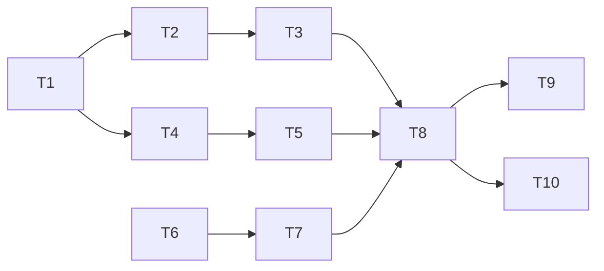

# 0005 Plan: search-and-csp-hardening

## 1. Summary
Fixes review 0006 findings C1, C2, C3. **One phase, about 6 to 9 hours**, under the usual 8-16 hour size because the change is three small, separate edits with no schema or infrastructure work. Critical path: classifier change (T1-T3) then CSP proxy (T6-T7) then browser sweep (T8). Tracks T1-T5 (search) and T6-T7 (CSP) are independent and can run in parallel. Estimates are tight except T8, whose cost depends on what the browser sweep finds.

Routing record: sequential. Run: architect (0005), searchability (0004), data-sanity (0004), backend-testing (0005), plan. Skipped by choice: dba (no schema), telemetry (existing metrics suffice), devops (no new component or setting), ux (one-line NOT note move, in T5).

## 2. Inputs
All listed in the front matter. Missing and not needed: dba, telemetry, devops, ux specs for this feature.

## 3. Blockers and open questions
No blockers. Defaults to confirm during the work (all `UNCONFIRMED`, owner: Simon):
- Symbol rule: exclude `\p{S}` (such as `$`, `€`, emoji) from the non-Latin test (search spec 0004 section 4).
- `empty_term` parse error for terms that normalise to nothing (sanitisation 0004 FP-D1).

## 4. Consistency report
| # | Finding | Class | Action |
| --- | --- | --- | --- |
| 1 | ADR-0031 ("quoted = exact") and ADR-0036 (bare exact, stem only with `*`) are partly superseded by ADR-0038 for non-Latin terms | Note | Do not edit accepted ADRs; add a "see ADR-0038" note line in the README search paragraph (T9); optionally add a superseded-by note via carma-architect |
| 2 | Two accepted files are numbered ADR-0036 | Risk | Refer to them by file name in docs; fix with an ADR via carma-architect if it matters; never renumber |
| 3 | An unrelated ADR-0037 (upload open when enabled) was added by another session while this work ran; this feature's ADRs were renumbered to 0038-0040 | Note | None; check that no file still cites "ADR-0037" for script-first matching (T9) |
| 4 | README says "Bare Latin terms are exact; Arabic/CJK use substring" | Note | Consistent with ADR-0038; extend with "quoted and starred non-Latin terms also use substring" and the NOT rule |
| 5 | Review 0006 mapping: C1 -> ADR-0038, C2 -> ADR-0039, C3 -> ADR-0040 | Note | Mark C1-C3 as addressed in a short follow-up review after the work |
| 6 | Search spec 0004 recommends excluding symbols from the non-Latin test; ADR-0038 says "any non-Latin letter" | Risk | Consistent in intent (letters only); confirm the default (section 3) |
| 7 | Review 0005's `isNonLatin` item was already closed by the current `termHasNonLatinLetter` | Note | None |
| 8 | `echo.ts` renders quotes as typed and claims nothing about exactness | Note | No change; only the notes change |
| 9 | Nothing in this feature has been run end to end; C1 was reproduced only at SQL level on a scratch Postgres | Risk | T3 and T8 are the first end-to-end checks |
| 10 | The unit test `upload-auth` and ADR-0037 describe open upload; unrelated | Note | Out of scope |

Principle check: P3 is served (fewer misses) at a stated precision cost; no principle is traded without an ADR.

## 5. Dependency graph
| Task | Depends on | Track |
| --- | --- | --- |
| T1 | none | search |
| T2 | T1 | search |
| T3 | T2 | search |
| T4 | T1 | search |
| T5 | T4 | search |
| T6 | none | csp |
| T7 | T6 | csp |
| T8 | T3, T5, T7 | join |
| T9 | T8 | docs |
| T10 | T8 | gate |

## 6. Phase 1: harden search terms and CSP (6 to 9 hours)
Goal: quoted and starred Chinese and Arabic terms find their articles, the NOT rule is visible, and scripts need a nonce.
Entry criteria: ADRs 0038-0040 accepted (done); a Postgres for integration tests (the Compose `db`, or a disposable instance).
Safe stop: after T3 the search change stands alone; after T7 the CSP change stands alone. If the browser sweep (T8) fails, revert only T6-T7 (restore the CSP entry in `next.config.ts`).
Human checkpoints: T1 symbol rule default; T8 reading the browser sweep; T10 review.

### T1 Classify terms by script first (1 to 1.5 h, agent)
- Why: C1, ADR-0038, P3, P5. FP-1, FP-S1, HP-1.
- Steps: in [leaf.ts](../../src/lib/search/leaf.ts) make `classifyLeaf` test non-Latin script before `wildcard` and quote branches; narrow `termHasNonLatinLetter` so symbols (`\p{S}`) do not count; keep Latin results unchanged. Write U1, U2 first.
- Where: `src/lib/search/leaf.ts`, `tests/unit/search-classify-script.test.ts`.
- Acceptance: U1, U2 pass; `npm run typecheck` clean.

### T2 Compile non-Latin phrase and wildcard as substring (1 to 1.5 h, agent)
- Why: ADR-0038. FP-2, FP-S2.
- Steps: in [compile.ts](../../src/lib/search/compile.ts) route `substring` kind for quoted multi-word and starred non-Latin terms; collapse whitespace in the normalised phrase; keep all `$n` referenced; apply `escapeIlike` after normalisation. Add `empty_term` check in [parse.ts](../../src/lib/search/parse.ts) (after `normaliseLeafTerm`; FP-D1).
- Where: `compile.ts`, `parse.ts`, `tests/unit/search-compile-nonlatin.test.ts`, `tests/unit/parse.test.ts`.
- Acceptance: U3, U4 pass; existing `parse.test.ts` and `search-compile-translation.test.ts` still pass.

### T3 Prove it on a real database (1 h, agent)
- Why: C1 was verified only at SQL level. FP-3.
- Steps: add `tests/integration/search-nonlatin.test.ts` with the real text of sample articles 8 and 9, golden cases G18-G27, escape cases, 20-short-term OR case; optionally add the I7 `EXPLAIN` note.
- Acceptance: I1-I6 pass; a tatweel-only query returns 400 `empty_term`.

### T4 Make notes follow the leaf class (0.5 h, agent)
- Why: ADR-0038, ADR-0040. FP-S3.
- Steps: in [run.ts](../../src/lib/search/run.ts) trigger the non-Latin note from "at least one `substring` leaf" instead of the raw query text, with the wording in search spec 0004 section 6; trigger the NOT note from the AST (`and_not`), not a regex on the raw query. Add U5.
- Acceptance: U5 passes (a quoted word `"NOT"` does not trigger the NOT note).

### T5 Show the NOT rule beside the query (0.5 h, agent)
- Why: C3, ADR-0040, P7.
- Steps: in [SearchPage.tsx](../../src/components/search/SearchPage.tsx) render the NOT note under the "Interpreted as" line (around line 296); keep it in `echo_notes` for the API; avoid duplicates in the muted notes list.
- Acceptance: E4 passes (second half); manual look at the search page with `renewable AND NOT coal`.

### T6 Add the nonce CSP proxy (1 to 1.5 h, agent)
- Why: C2, ADR-0039. FP-4, FP-5, HP-D1.
- Steps: read the Next.js 16 guide at `node_modules/next/dist/docs/01-app/02-guides/content-security-policy.md` and the `proxy` file convention doc before writing (AGENTS.md); create `src/proxy.ts` with the header from sanitisation spec 0004 section 4, matcher excluding `/api`, `_next/static`, `_next/image`, favicon; set `x-nonce`; no I/O in the function. Remove the CSP entry from [next.config.ts](../../next.config.ts).
- Acceptance: U6, U7 pass.

### T7 Prove the header at the edge (0.5 to 1 h, agent)
- Steps: extend `scripts/smoke.sh` with the E5 header check; build and start the stack.
- Acceptance: `sh scripts/smoke.sh` passes with one CSP header carrying a nonce; no `unsafe-inline` in `script-src`.

### T8 Browser sweep (1 to 2 h, either; human reads the result)
- Why: FP-5, FP-6; guards against a blank page.
- Steps: add `tests/e2e/csp.spec.ts` (E1-E3) and the search checks in `tests/e2e/smoke.spec.ts` (E4); run against `docker compose up -d --build --wait`; look at each page in the built-in browser once.
- Acceptance: E1-E5 pass; no CSP errors in the console on `/`, `/trends`, `/status`, `/upload`, and article pages for samples 6 and 18; progress bars and chart swatches keep their style. If a page is blank or styled wrongly and cannot be fixed in 1 hour, revert T6-T7 and keep ADR-0039 option 3.

### T9 Update README and ADR pointers (0.5 h, agent)
- Steps: README search paragraph: quoted and starred non-Latin terms use substring; NOT excludes by original text only; CSP uses a per-request nonce for scripts and relaxed inline style attributes. Check no document still cites "ADR-0037" for script-first matching. Do not edit accepted ADRs.
- Acceptance: README matches the behaviour tested in T3/T8.

### T10 Run quality gates and a follow-up review (0.5 to 1 h, human decides)
- Steps: `npm test`, `npm run typecheck`, `npm run lint`; run carma-review on the diff and record which of C1-C3 are closed; the repository has no commits, so review the whole tree as before.
- Exit criteria of the phase: every test ID in the traceability table passes; review shows no new blocker.

## 7. Traceability
| Requirement or FP/HP | Task | Test |
| --- | --- | --- |
| C1 quoted/starred non-Latin terms miss | T1, T2, T3 | U1, U2, U4, I1, I2 |
| FP-1 / FP-S1 misclassification | T1 | U1, U2, I2 |
| FP-2 / FP-S2 phrase spacing | T2 | U4, I1 |
| FP-3 / HP-S1 short terms | T3 | I6, I7 |
| FP-D1 empty term | T2 | U3, I5 |
| FP-S3 note trigger | T4 | U5 |
| C3 / FP-7 NOT visibility | T4, T5 | I3, I4, U5, E4 |
| C2 nonce CSP / FP-4 | T6, T7 | U6, U7, E5 |
| FP-5 / FP-D4 nonce missing | T8 | E1 |
| FP-6 inline styles | T8 | E3 |
| Articles 6 and 18 inert | T8 | E2, sanitise.test.ts |
| HP-1 classifier readability | T1, T10 | U1, review |
| HP-3 / HP-D1 proxy cost | T6 | U6 |
No empty cells.

## 8. Risks and assumptions
- Symbol rule and `empty_term` rule are defaults, not user decisions.
- Duplicate ADR number 0036 remains.
- Nothing yet run end to end; the Next.js 16 proxy convention may differ in detail from the guide, so T6 starts by reading the docs.
- Short Chinese terms cause scans; bounded by the 2 s statement timeout.
- Estimate uncertainty: T8 (browser sweep) could double if a page needs nonce fixes.

## 9. Execution notes
Do T1-T3, T4-T5 and T6-T7 in any order; do T8 last. If an assumption proves false (for example the proxy cannot apply nonces to Next's own scripts), stop, keep the old CSP, and return to carma-architect with the evidence instead of loosening the policy. Commit nothing until the user asks; the repository has no commits yet.
